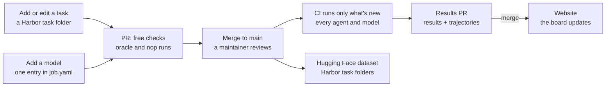

# ETH Evals

<h4 align="center">
  <a href="https://ethevals-site.vercel.app">Website</a> |
  <a href="https://ethevals-site.vercel.app/how-it-works">How it works</a> |
  <a href="docs/add-an-eval.md">Add a task</a>
</h4>

ETH Evals is an open task framework built on [Harbor](https://harborframework.com). It evaluates AI agents and models across four pillars of Ethereum work: concepts, transactions, building, and security.

- **A task is a Harbor folder**: an instruction, an environment, a verifier, and a solution.
- **New models on launch day**: adding one is a config change.
- **Every task proves itself**: its oracle run must pass and its nop run must fail.
- **Checks decide each trial**: every named check must pass.
- **Every trial is public**: each result links to its full trajectory.



## Requirements

Before you begin, install these tools:

- [Git](https://git-scm.com/downloads)
- [Python 3.13](https://www.python.org/downloads/) and [uv](https://docs.astral.sh/uv/getting-started/installation/)
- [Docker](https://docs.docker.com/get-started/get-docker/) with Compose, for agent trials
- [Node.js 22 or later](https://nodejs.org/en/download/) and [pnpm 9.14.2](https://pnpm.io/installation), for the website

## Quickstart

1. Clone the repository and install the runner:

```sh
git clone https://github.com/BuidlGuidl/ethevals.git
cd ethevals
uv sync --frozen
```

2. Start Docker and check the Harbor tasks without a model or provider key:

```sh
unset OPENROUTER_API_KEY ANTHROPIC_API_KEY OPENAI_API_KEY ANTHROPIC_AUTH_TOKEN EXA_API_KEY
uv run python scripts/ci.py images
uv run ethevals free-check --output results/quickstart
```

Each task's oracle run must pass, and its nop run must fail.
Use a fresh output directory each time.
Read [the Harbor guide](docs/harbor.md) for task inputs and check records.

3. Start the website in a second terminal, then open http://localhost:3000:

```sh
cd site
pnpm install --frozen-lockfile
pnpm run dev
```

**What's next**

- Write your own task with the [add-a-task guide](docs/add-an-eval.md).
- Add a model or an agent in [`job.yaml`](runner/ethevals/job.yaml).
- Look up scoring, limits, budgets, and CI in the [runner reference](runner/README.md).
- Build and check the website with the [site guide](site/README.md).
- Look up words like mode, agent, and trial in the [glossary](CONTEXT.md).
