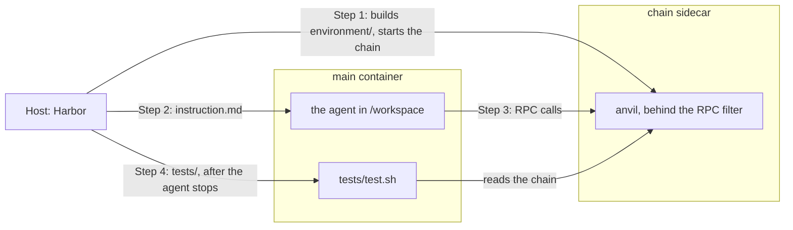

> **Agents:** read the [`create-task`](../.agents/skills/create-task/SKILL.md) and [`rewardkit`](../.agents/skills/rewardkit/SKILL.md) skills for Harbor's mechanics, then use this guide for our rules. The rest of the guide is for people.

# Introduction

## What is a task?

A task is an instruction for an agent or a bare model, plus the checks that decide whether it did it right.
You write the instruction, what the agent starts with, the checks, and a solution, all in one [Harbor](https://harborframework.com) task folder.

## The task folder

Every task belongs to one of four pillars:

- `concepts`
- `transactions`
- `building`
- `security`

The pillar describes the work, not its tools. You build a security task like any other, so start from the recipe with the same needs.

A task lives in `tasks/<pillar>/<task_name>/`:

```text
tasks/
└── <pillar>/
    └── <task_name>/
        ├── task.toml                 required: the name, description, modes, and how the verifier runs
        ├── README.md                 required: what the task touches and why it matters, for people
        ├── instruction.md            required: the message the agent or model gets
        ├── environment/              required: the agent's container and the files it starts with
        │   ├── Dockerfile
        │   ├── docker-compose.yaml   optional: sidecars the agent can call, like a chain
        │   ├── Chain.Dockerfile      required if there's a chain: the chain sidecar's image
        │   └── setup/                required if there's a chain: setup.s.sol, which prepares the chain before the agent starts
        ├── tests/                    required: test.sh and the checks
        └── solution/                 required: solve.sh, which proves every check can pass
```

Let's look at each piece:

### `task.toml`

`task.toml` holds the task's settings: its name, why it exists, the modes it runs in, and how Harbor runs its verifier. It takes these keys:

| Key                           | Required          | Holds                                                                     |
| ----------------------------- | ----------------- | ------------------------------------------------------------------------- |
| `schema_version`              | yes               | `"1.3"`, the version of Harbor's task format                              |
| `[task].name`                 | yes               | `buidlguidl/<task_name>`, the task's name everywhere it's published       |
| `[task].description`          | yes               | one line on why the task exists, shown on the website                     |
| `[task].authors`              | no                | who wrote it, like `[{ name = "BuidlGuidl" }]`                            |
| `[task].keywords`             | no                | a few words to find it by                                                 |
| `[metadata].pillar`           | yes               | the pillar, which must match the parent folder                            |
| `[metadata].modes`            | yes               | any of `vanilla`, `internet`, and `skills`                                |
| `[verifier].environment_mode` | no                | `shared` for a task with a chain, `separate` for one without              |
| `[verifier].user`             | no                | `root` for Forge tests                                                    |
| `[verifier.env]`              | if it has criteria | the judge's key, and nothing else                                        |
| `artifacts`                   | if it's `separate` | the paths Harbor copies from the agent's container to the verifier       |
| `[environment]`               | no                | `cpus` and `memory_mb` for the agent's container                          |

`modes` picks how the task runs:

- `vanilla`: sends the instruction to a bare model in one API call, with no tools. Use it only for a question a bare model can answer in one reply.
- `internet`: runs an agent as it ships, with the web, a shell, its container, and the task's sidecars. Use it for work that needs an agent's tools or environment.
- `skills`: `internet` plus the [skills pack](../skills/README.md). List it with `internet` for any agent task.

Leave out what the board decides.
Which agents run, how many trials each gets (`n_attempts`), and how many retries a trial gets after an error all live in the board's [job config](../runner/ethevals/job.yaml).
The board sets no time limit of its own, so Harbor's defaults apply. The agent has none, and the verifier gets 10 minutes.
Add `[agent].timeout_sec` or `[verifier].timeout_sec` only when your task needs a different one.

### `README.md`

`README.md` tells people why the task exists and what it catches.
Harbor Hub and the Hugging Face dataset publish it with the task, and the agent never sees it.
Use these sections, in this order:

| Section               | Holds                                                                         |
| --------------------- | ----------------------------------------------------------------------------- |
| `# <title>`           | two or three sentences on what the user asks and what the task checks        |
| `## The instruction`  | `instruction.md`, word for word, in a blockquote, so it wraps on GitHub        |
| `## What it touches`  | the areas the task touches, and the gotchas in each that the instruction leaves out |
| `## The checks`       | a table with every check by name, what it proves, and its area                |
| `## Why it matters`   | where the same gotchas hurt real projects, with links                         |
| `## Notes`            | optional caveats, such as a known contract that passes every check            |

A unit test fails the pull request if a section is missing, if the quoted instruction differs from `instruction.md`, or if the table leaves out a check.
Write the README before the tests.
If you can't name a gotcha that the instruction leaves out, the task probably won't tell agents apart.
The [revenue payouts README](../tasks/building/revenue-payouts/README.md) is a full example.

### `instruction.md`

`instruction.md` is the message the agent or model gets, word for word.

Write it the way a real person would send it. The board measures ordinary work, and an agent that knows how it's being checked can act differently.
So keep the tests, the target, the criteria, and the solution out of it, and out of the files the agent starts with.
Lint fails if `instruction.md` or any file under `environment/` uses words like eval, benchmark, rubric, grader, score, or epoch.

If the tests import the agent's code, name the file, the contract, and the constructor, so the tests can find them.
If the agent needs something setup made, like a wallet or a contract address, point it at `chain_context.json`.

### `environment/`

`environment/` builds the container the agent works in. Harbor calls it `main`.

**Dockerfile.** Start from one of our shared images, pinned by tag:

- `ghcr.io/buidlguidl/ethevals-quiz` for a quiz.
- `ghcr.io/buidlguidl/ethevals-chain` for everything else. It has Foundry, Solidity 0.8.30, and forge-std.

Both have RewardKit and the helpers the tests use. Copy the pin from one of the recipes. Lint fails if a pin doesn't match the image's build inputs.

The chain image starts a chain by default. When the agent's container is built on it, its Dockerfile clears that with `ENTRYPOINT []` and keeps the container running with `CMD ["sleep", "infinity"]`, as the recipes do.

**Starting files.** Put the files the agent starts with next to the Dockerfile, and `COPY` them into `/workspace`, like a Foundry project to build on.
Keep them as plain files. Lint refuses symlinks anywhere in the task folder.

Keep the task's own facts and setup inside its folder, not in the shared images.
Anyone can run the published folder with plain Harbor and no ETH Evals code, and it must behave as it does on the board.
So a task can't rely on changes to the runner.

**Sidecars.** Declare containers that run next to the agent's, like a chain, in `environment/docker-compose.yaml`.
Declare only the ones the task needs.
Compose names the agent's container `main`.
Lint allows a short list of compose options: no host mounts, no host network, no privileged containers, and every build stays inside the task folder.

For a chain, copy `Chain.Dockerfile` and `docker-compose.yaml` from the [fresh chain recipe](#task-with-a-fresh-chain).
The chain sidecar starts anvil, runs your setup, and only then lets the agent start.
The agent reaches it at `http://chain:8545`, through a filter that refuses anvil's cheat methods, like `anvil_setBalance`, and methods that ask the chain to sign, like `eth_sendTransaction`.
So the agent signs its own transactions, as it would on a real network.

**Secrets.** Keep credential values out of task files.
When a sidecar needs one, like a fork's RPC URL, compose takes it from the host as `${VAR:?message}`, and stops with your message if it's missing.
Give it only to the sidecar that needs it.
Don't put it in `[environment.env]` in `task.toml`, because Harbor can pass that into the agent's container.
A task can't ask for the board's own credentials, like the model keys.

### `environment/setup/`

`setup/` runs in the chain sidecar before the agent starts, and prepares the chain. For example, it can make the wallet the agent uses, fund it, or deploy the contracts the task asks about. The agent never sees it.

Setup scripts are Solidity files, `setup/setup.s.sol`, and the chain runs them with `forge script`. So you can use anything Foundry gives you, and call anvil methods through `vm.rpc`.

Your script extends our `ChainSetup` helper, which gives you these functions:

- `fund(addr, amount)`: sets the ETH balance of `addr`.
- `chainRecord(name, value)`: adds a field to `chain_context.json`, which the agent and the tests read.
- `privateRecord(name, value)`: adds a field to `private_chain_context.json`, which only the tests read.

Both record functions take an address, a `uint256`, a `bytes32`, or a string.
`ChainSetup` writes `rpcUrl` and `chainId` into `chain_context.json` for you.
Setup runs again for every trial, so you don't have to fix contract addresses or the agent's wallet ahead of time.

Here's where each file lands:

| File                         | The agent reads it at                                                                   | The tests read it at                                                          |
| ---------------------------- | --------------------------------------------------------------------------------------- | ----------------------------------------------------------------------------- |
| `chain_context.json`         | `/workspace/chain_context.json`, read-only, through a link the task's Dockerfile makes | `/chain/chain_context.json`, or `chain_context.json` in Forge                 |
| `private_chain_context.json` | never, because only root can open its folder                                            | `/private/private_chain_context.json`, or `private_chain_context.json` in Forge |

The recipes below show two real setups.

### `tests/`

`tests/` holds the checks that decide whether the agent got it right.
Harbor copies it in only after the agent stops, and runs `tests/test.sh`.

A check is one pass-or-fail result with a name and a one-line reason. A trial passes only if every check passes.
Check the outcome the instruction asked for, and give every failure a reason that says what went wrong.
Split separate requirements into separate checks, so a failure tells readers which one broke.
You pick the checks that fit your task, and you can use more than one kind:

| File                                                | Checks                                           |
| --------------------------------------------------- | ------------------------------------------------ |
| a Python file that calls `rk.final_answer`          | the final reply, against a target                |
| `tests/*.t.sol`                                     | the chain, the agent's code, or both, with Forge |
| a RewardKit judge file, like `tests/transfer.toml`  | the trajectory, with criteria a judge answers    |

**Target.** For a quiz, you write a rule that accepts the right reply, and the check runs it on the agent's final reply.

<details>
<summary>Example target</summary>

```python
import string
import sys

sys.path.insert(0, "/opt")  # (1)
import target_checks
import rewardkit as rk

rk.final_answer(
    lambda reply: reply.strip(string.whitespace + string.punctuation).endswith("8004"),  # (2)
    name="erc_number",  # (3)
)
```

1. The quiz image keeps `target_checks.py` in `/opt`. Importing it adds `rk.final_answer`.
2. The rule gets the final reply and returns true or false. This one trims spaces and punctuation, then wants `8004` at the end, so `8004`, `ERC-8004`, and `It's ERC-8004.` all pass.
3. The check's name.

A wrong reply fails with the reason `Answer does not match the target.`, and an empty one with `The answer is empty.`
The reply comes from the agent's trajectory, `/logs/agent/trajectory.json`.

</details>

**Forge tests.** Each test function is one check. Tests can read the chain, import the agent's code, or both.

<details>
<summary>Example test</summary>

```solidity
    function test_recipient_balance() public view {  // (1)
        assertEq(token.balanceOf(recipient), 12_500_000, "recipient holds 12.5 tokens in base units");  // (2)
    }
```

1. The function name is the check's name.
2. If the assertion fails, its message becomes the reason, like `recipient holds 12.5 tokens in base units: 1250000 != 12500000`.

`tests/test.sh` runs them:

```sh
#!/bin/sh
set -eu
python3 /opt/forge_checks.py  # (1)
cp /opt/check_records.py /tests/check_records.py  # (2)
rewardkit /tests  # (3)
```

1. Copies the agent's files and your tests into a fresh Forge project, runs `forge test`, and writes one record for each test. It adds a `compile` check, and if that fails, every test fails with it.
2. Puts our shared check next to your tests. It turns each record into a check with its reason.
3. RewardKit runs every check in `tests/` and writes the reward.

</details>

**Other test tools.** Any tool can feed the same checks. It ships in your task's image, runs from `test.sh` before RewardKit, and writes `/logs/verifier/checks.json`, with one record for each check:

```json
{"check_name": {"passed": true, "reason": "A one-line reason."}}
```

Read [Verifiers](../runner/README.md#verifiers) before you add one.

**Criteria.** A judge answers yes-or-no questions about what only the trajectory shows, like whether the agent checked its work. Use criteria only for what no test can check. Each criterion is one check.

<details>
<summary>Example criteria</summary>

```toml
[judge]
judge = "anthropic/claude-opus-5-5"  # (1)
reasoning_effort = "high"
atif-trajectory = "/logs/agent/trajectory.json"  # (2)
guard = "flag"  # (3)

[scoring]
aggregation = "all-pass"  # (4)

[[criterion]]
name = "verified_transfer"  # (5)
type = "binary"
description = "Before reporting success, did the agent confirm on-chain that the transfer landed, for example by reading the transaction receipt or the recipient's token balance?"  # (6)
```

1. The judge for a plain Harbor run. The board sets one judge model and effort for every task.
2. The judge reads the agent's trajectory.
3. Reports any instructions the agent wrote for the judge.
4. Every criterion must pass.
5. The check's name.
6. The question. The judge answers yes or no and writes the reason.

</details>

Lint checks every judge file against the board's rules:

- Every criterion is yes-or-no, with its own name.
- The judge reads `/logs/agent/trajectory.json`.
- Its guard is `flag` or `penalize`.
- Every criterion counts toward `all-pass`.

The judge needs an API key. A task with criteria declares exactly this in `task.toml`, and no other credential:

```toml
[verifier.env]
ANTHROPIC_API_KEY = "${ANTHROPIC_API_KEY}"
```

The free check can't run the judge, because that's a paid call. So read each question yourself, and make sure the trajectory can answer it. Reviewers check this too.

**`reward.toml`.** Every task has a `tests/reward.toml` that makes the reward 1 only when every check passes:

```toml
[scoring.check_records]  # (1)
aggregation = "all-pass"

[[reward]]
name = "reward"  # (2)
aggregation = "all-pass"
```

1. The checks from `check_records.py`. A quiz names its own file instead, like `[scoring.answer]` for `answer.py`.
2. The trial's reward. A trial passes when it's 1.

RewardKit writes `reward.json` and `reward-details.json` to `/logs/verifier/`. The board reads each check and its reason from `reward-details.json`.

### `solution/`

`solution/solve.sh` is a working answer. Harbor's oracle agent runs it in place of an agent, to prove every check can pass.
It runs in the agent's container, so it uses only what the agent gets: the instruction, the starting files, and `chain_context.json`.
Put any files it needs next to it. Harbor copies `solution/` to `/solution`.

A quiz or a task with criteria also needs a trajectory, which the oracle agent doesn't write.
So its solution writes a stand-in to `/logs/agent/trajectory.json`, in Harbor's ATIF format.

We publish every task's files, solutions included, in our [Hugging Face dataset](https://huggingface.co/datasets/buidlguidl/ethevals-test).
Training on them is welcome, but the board can't tell a learned answer from new work.

### How a trial runs

A trial is one agent or model doing a task once, in one mode. Here is a trial of a task with a chain:



1. Harbor builds `environment/` and starts the chain sidecar. The sidecar runs `setup/setup.s.sol`, which writes `chain_context.json` and `private_chain_context.json`.
2. Once setup is done, Harbor starts the agent in `main` and sends it `instruction.md`.
3. The agent works in `/workspace` and talks to the chain over RPC. It never sees `tests/`, `solution/`, or `private_chain_context.json`.
4. When the agent stops, Harbor copies `tests/` into `main` and runs `test.sh` as root. The tests read both context files and the chain as the agent left it, and the judge reads the trajectory. RewardKit writes the reward.

A task without a chain has no sidecar, and its verifier is `separate`.
When the agent stops, Harbor saves the paths in `artifacts` and stops `main`.
Then it starts a fresh container from the same image, copies those paths back in, and runs `tests/` there.
In the `vanilla` mode, our one-call agent sends the instruction to the bare model and saves its reply as the trajectory.

## Recipes

Start from the recipe closest to your task. Each one is a real task, and the free check keeps it working.

### Simple quiz

This recipe checks the reply against a target.
It's [`tasks/concepts/agent-registries`](../tasks/concepts/agent-registries).

```text
agent-registries/
├── task.toml
├── README.md
├── instruction.md
├── environment/
│   └── Dockerfile
├── tests/
│   ├── test.sh
│   ├── reward.toml
│   └── answer.py
└── solution/
    └── solve.sh
```

```toml
schema_version = "1.3"
artifacts = ["/logs/agent/trajectory.json"]  # (1)

[task]
name = "buidlguidl/agent-registries"
description = "Check whether a model knows the ERC for agent discovery and trust."  # (2)
authors = [{ name = "BuidlGuidl" }]
keywords = ["ethereum", "erc", "agent-discovery"]

[metadata]
pillar = "concepts"
modes = ["vanilla", "internet", "skills"]  # (3)

[verifier]
environment_mode = "separate"  # (4)

[environment]
cpus = 1
memory_mb = 1024
```

1. Copies the agent's trajectory to the verifier, which reads the final reply from it.
2. The website shows it. The agent never sees it.
3. A quiz needs no tools, so it can run in `vanilla`.
4. There's no chain to read, so the verifier checks the reply in a fresh container.

`instruction.md` asks the way a person would:

```text
which ERC defines onchain identity, reputation and validation registries for AI agents? just the number please
```

<details>
<summary><code>environment/Dockerfile</code></summary>

```dockerfile
FROM ghcr.io/buidlguidl/ethevals-quiz:inputs-477f6b3f35664858
```

The quiz image has RewardKit and the target helper. A quiz needs nothing else.

</details>

`tests/answer.py` is the [target example](#tests) above.

<details>
<summary><code>tests/test.sh</code> and <code>tests/reward.toml</code></summary>

```sh
#!/bin/sh
set -eu
rewardkit /tests
```

A quiz has no test tool, so `test.sh` only runs RewardKit.

```toml
[scoring.answer]  # (1)
aggregation = "all-pass"

[[reward]]
name = "reward"
aggregation = "all-pass"
```

1. The checks in `answer.py`.

</details>

<details>
<summary><code>solution/solve.sh</code></summary>

```sh
#!/bin/sh
set -eu
mkdir -p /logs/agent
cat > /logs/agent/trajectory.json <<'EOF'
{
  "schema_version": "ATIF-v1.7",
  "session_id": "solution",
  "agent": {"name": "oracle", "version": "1.0.0"},
  "steps": [{"step_id": 1, "source": "agent", "message": "8004"}]
}
EOF
```

The oracle agent gives no reply, so the solution writes a one-step trajectory whose last message is the answer.

</details>

To prove the target catches a wrong answer, change `"8004"` in `solve.sh` to `"8005"` and run the [free check](#check-your-task).
The oracle run now fails, and its `reward-details.json` gives the reason `Answer does not match the target.` Change it back.

### Task with a fresh chain

This recipe checks what the agent did on a chain.
Setup deploys a token with 6 decimals, the agent sends 12.5 of it, Forge tests read the balances, and a criterion asks whether the agent confirmed the transfer.
It's [`tasks/transactions/send-six-decimal-token`](../tasks/transactions/send-six-decimal-token).

```text
send-six-decimal-token/
├── task.toml
├── README.md
├── instruction.md
├── environment/
│   ├── Dockerfile
│   ├── Chain.Dockerfile
│   ├── docker-compose.yaml
│   └── setup/
│       ├── setup.s.sol
│       └── Token.sol
├── tests/
│   ├── test.sh
│   ├── reward.toml
│   ├── Transfer.t.sol
│   └── transfer.toml
└── solution/
    ├── solve.sh
    ├── solution.s.sol
    └── confirm.py
```

<details>
<summary><code>task.toml</code></summary>

```toml
schema_version = "1.3"

[task]
name = "buidlguidl/send-six-decimal-token"
description = "Check whether an agent reads token decimals before signing an exact transfer."
authors = [{ name = "BuidlGuidl" }]
keywords = ["ethereum", "erc20", "transfers"]

[metadata]
pillar = "transactions"
modes = ["internet", "skills"]  # (1)

[verifier]
environment_mode = "shared"  # (2)
user = "root"  # (3)

[verifier.env]
ANTHROPIC_API_KEY = "${ANTHROPIC_API_KEY}"  # (4)

[environment]
cpus = 1
memory_mb = 4096
```

1. A bare model can't send a transaction, so no `vanilla`.
2. The tests run in the agent's container, while the chain is still up.
3. Only root can read `private_chain_context.json`.
4. The judge's key, for the criterion.

</details>

`instruction.md`:

```text
can you send 12.5 tokens to the recipient in chain_context.json? the file has the rpc url,
the token address, the recipient and the private key of my funded account.
```

<details>
<summary><code>environment/Dockerfile</code> and <code>environment/Chain.Dockerfile</code></summary>

The agent's container:

```dockerfile
FROM ghcr.io/buidlguidl/ethevals-chain:inputs-d0ef1955a98ec678
WORKDIR /workspace
RUN ln -s /chain/chain_context.json /workspace/chain_context.json
ENTRYPOINT []
CMD ["sleep", "infinity"]
```

The link puts `chain_context.json` in the agent's folder. The image makes the link, so the task folder has no symlink.

The chain sidecar:

```dockerfile
FROM ghcr.io/buidlguidl/ethevals-chain:inputs-d0ef1955a98ec678
USER root
COPY setup/ /setup/
ENTRYPOINT ["python3", "/opt/start_chain.py"]
```

Only the sidecar gets `setup/`. `start_chain.py` starts anvil behind the RPC filter, runs setup, and writes both context files.

</details>

<details>
<summary><code>environment/docker-compose.yaml</code></summary>

```yaml
services:
  main:  # (1)
    build:
      context: .
      dockerfile: Dockerfile
    user: agent  # (2)
    volumes:
      - public-context:/chain:ro  # (3)
      - private-context:/private:ro
    depends_on:
      chain:
        condition: service_healthy  # (4)
  chain:  # (5)
    build:
      context: .
      dockerfile: Chain.Dockerfile
    mem_limit: 3g
    volumes:
      - public-context:/chain
      - private-context:/private
    healthcheck:
      test: [CMD-SHELL, "test -f /tmp/chain-ready && cast chain-id --rpc-url http://127.0.0.1:8545"]  # (6)
      interval: 1s
      timeout: 3s
      retries: 180
volumes:
  public-context: {}
  private-context: {}
```

1. The agent's container.
2. The agent runs as `agent`, so it can't open `/private`.
3. Setup's files arrive read-only.
4. The agent starts only after setup is done.
5. The chain sidecar. The agent reaches it at `http://chain:8545`.
6. Passes once setup has written both context files.

</details>

<details>
<summary><code>environment/setup/setup.s.sol</code></summary>

```solidity
// SPDX-License-Identifier: MIT
pragma solidity 0.8.30;

import {ChainSetup} from "ethevals/ChainSetup.sol";  // (1)
import {Vm} from "forge-std/Vm.sol";
import {Token} from "./Token.sol";  // (2)

contract Setup is ChainSetup {
    function run() external {
        Vm.Wallet memory me = vm.createWallet(vm.randomUint(1, SECP256K1_ORDER - 1));  // (3)
        Vm.Wallet memory deployer = vm.createWallet(vm.randomUint(1, SECP256K1_ORDER - 1));
        address recipient = vm.randomAddress();
        fund(me.addr, 10 ether);  // (4)
        fund(deployer.addr, 1 ether);

        vm.startBroadcast(deployer.privateKey);
        Token token = new Token(me.addr);
        vm.stopBroadcast();

        chainRecord("privateKey", bytes32(me.privateKey));  // (5)
        chainRecord("recipient", recipient);
        chainRecord("token", address(token));
        privateRecord("sender", me.addr);  // (6)
    }
}
```

1. Gives you `fund`, `chainRecord`, and `privateRecord`.
2. Setup can deploy its own contracts.
3. Makes a new random wallet for each trial.
4. Sets the wallet's ETH balance.
5. Adds a field to `chain_context.json`.
6. Adds a field to `private_chain_context.json`, for the tests.

</details>

<details>
<summary><code>environment/setup/Token.sol</code></summary>

```solidity
// SPDX-License-Identifier: MIT
pragma solidity =0.8.30;

contract Token {
    string public constant name = "Six Decimal Token";
    string public constant symbol = "SIX";
    uint8 public constant decimals = 6;  // (1)
    uint256 public constant totalSupply = 1000 * 10 ** 6;
    mapping(address => uint256) public balanceOf;
    mapping(address => mapping(address => uint256)) public allowance;
    event Transfer(address indexed from, address indexed to, uint256 value);
    event Approval(address indexed owner, address indexed spender, uint256 value);

    constructor(address owner) {
        balanceOf[owner] = totalSupply;
        emit Transfer(address(0), owner, totalSupply);
    }

    function transfer(address to, uint256 amount) external returns (bool) {
        _transfer(msg.sender, to, amount);
        return true;
    }

    function approve(address spender, uint256 amount) external returns (bool) {
        allowance[msg.sender][spender] = amount;
        emit Approval(msg.sender, spender, amount);
        return true;
    }

    function transferFrom(address from, address to, uint256 amount) external returns (bool) {
        allowance[from][msg.sender] -= amount;
        _transfer(from, to, amount);
        return true;
    }

    function _transfer(address from, address to, uint256 amount) private {
        require(to != address(0));
        balanceOf[from] -= amount;
        balanceOf[to] += amount;
        emit Transfer(from, to, amount);
    }
}
```

1. An agent that assumes 18 decimals sends the wrong amount. 12.5 tokens are 12,500,000 base units.

</details>

<details>
<summary><code>tests/Transfer.t.sol</code></summary>

```solidity
// SPDX-License-Identifier: MIT
pragma solidity 0.8.30;

import {Test} from "forge-std/Test.sol";
import {stdJson} from "forge-std/StdJson.sol";
import {IERC20} from "forge-std/interfaces/IERC20.sol";

contract TransferCheck is Test {
    using stdJson for string;

    address recipient;
    IERC20 token;
    address sender;

    function setUp() public {
        string memory chain = vm.readFile("chain_context.json");  // (1)
        recipient = chain.readAddress(".recipient");
        token = IERC20(chain.readAddress(".token"));
        sender = vm.readFile("private_chain_context.json").readAddress(".sender");  // (2)
        vm.createSelectFork("chain");  // (3)
    }

    function test_recipient_balance() public view {  // (4)
        assertEq(token.balanceOf(recipient), 12_500_000, "recipient holds 12.5 tokens in base units");  // (5)
    }

    function test_sender_balance() public view {  // (6)
        assertEq(token.balanceOf(sender), 987_500_000, "sender spent exactly 12.5 tokens");
    }
}
```

1. Tests read `chain_context.json`.
2. And `private_chain_context.json`, which the agent never sees.
3. Forks the chain as the agent left it.
4. Each `test` function is one check.
5. The message is the reason when the check fails.
6. A second requirement gets its own check, so a failure says which one broke.

</details>

`tests/transfer.toml` is the [criteria example](#tests) above, and `tests/test.sh` and `tests/reward.toml` are the same as there.

<details>
<summary><code>solution/solve.sh</code></summary>

```sh
#!/bin/sh
set -eu
cd /workspace  # (1)
test -r chain_context.json  # (2)
test ! -r /private/private_chain_context.json  # (3)
cat > /workspace/foundry.toml <<'EOF'
[profile.default]
src = "/solution"
remappings = ["forge-std/=/opt/solidity/lib/forge-std/src/"]
ffi = false
fs_permissions = [{access = "read", path = "/workspace/chain_context.json"}]
EOF
forge script /solution/solution.s.sol --root /workspace --broadcast --rpc-url http://chain:8545  # (4)
python3 /solution/confirm.py  # (5)
```

1. Starts where the agent does.
2. Checks that it can read the chain context, like the agent.
3. Proves the agent can't read the private chain context.
4. Sends the tokens.
5. Confirms the transfer, the way the criterion asks.

</details>

<details>
<summary><code>solution/solution.s.sol</code></summary>

```solidity
// SPDX-License-Identifier: MIT
pragma solidity 0.8.30;

import {Script} from "forge-std/Script.sol";
import {stdJson} from "forge-std/StdJson.sol";
import {IERC20} from "forge-std/interfaces/IERC20.sol";

contract Solution is Script {
    using stdJson for string;

    function run() external {
        string memory chain = vm.readFile("chain_context.json");  // (1)
        IERC20 token = IERC20(chain.readAddress(".token"));
        uint256 amount = 125 * 10 ** token.decimals() / 10;  // (2)
        vm.startBroadcast(uint256(chain.readBytes32(".privateKey")));
        token.transfer(chain.readAddress(".recipient"), amount);
        vm.stopBroadcast();
    }
}
```

1. Uses only what the agent gets.
2. Reads the decimals from the chain.

</details>

<details>
<summary><code>solution/confirm.py</code></summary>

```python
import json
from pathlib import Path
import subprocess

chain = json.loads(Path("/workspace/chain_context.json").read_text())
command = ["cast", "call", chain["token"], "balanceOf(address)(uint256)", chain["recipient"],
           "--rpc-url", chain["rpcUrl"]]
balance = subprocess.check_output(command, text=True).strip()  # (1)
assert int(balance.split()[0]) == 12_500_000, balance
trajectory = {  # (2)
    "schema_version": "ATIF-v1.7", "session_id": "solution",
    "agent": {"name": "oracle", "version": "1.0.0"},
    "steps": [
        {"step_id": 1, "source": "agent", "message": "Read the recipient's token balance after the transfer.",
         "tool_calls": [{"tool_call_id": "balance", "function_name": "shell",
                         "arguments": {"command": " ".join(command)}}],
         "observation": {"results": [{"source_call_id": "balance", "content": balance}]}},
        {"step_id": 2, "source": "agent", "message": "The recipient holds 12.5 tokens. The transfer succeeded."},
    ],
}
Path("/logs/agent").mkdir(parents=True, exist_ok=True)
Path("/logs/agent/trajectory.json").write_text(json.dumps(trajectory))
```

1. Reads the recipient's balance from the chain.
2. Writes a stand-in trajectory that shows the check, so the criterion can pass on the solution.

</details>

To prove the tests catch a wrong answer, change `amount` in `solution.s.sol` to `125 * 10 ** 4` and run the [free check](#check-your-task).
The oracle run now fails, and its `reward-details.json` gives your assertion message as the reason: `recipient holds 12.5 tokens in base units: 1250000 != 12500000`. Change it back.

### Task on a mainnet fork

To check against a live protocol, the chain sidecar forks mainnet at a pinned block.
This recipe has the agent supply 10,000 USDC to Aave. Setup moves USDC to the agent's wallet, and Forge tests read the wallet's balances and allowance.
It's [`tasks/transactions/supply-usdc-to-aave`](../tasks/transactions/supply-usdc-to-aave).

```text
supply-usdc-to-aave/
├── task.toml
├── README.md
├── instruction.md
├── environment/
│   ├── Dockerfile
│   ├── Chain.Dockerfile
│   ├── docker-compose.yaml
│   └── setup/
│       └── setup.s.sol
├── tests/
│   ├── test.sh
│   ├── reward.toml
│   └── Supplied.t.sol
└── solution/
    ├── solve.sh
    └── solution.s.sol
```

It's built like the fresh chain recipe, with no criteria. The fork lives in the chain sidecar's part of `docker-compose.yaml`:

```yaml
    environment:
      FORK_RPC_URL: ${MAINNET_RPC_URL:?MAINNET_RPC_URL is required}  # (1)
      FORK_BLOCK_NUMBER: "23819000"  # (2)
```

1. The RPC URL comes from the host and reaches only the chain sidecar. Compose stops with this message if it's missing.
2. Pins the block, so every trial starts from the same state.

`instruction.md`:

```text
i have 25,000 USDC in my account. can you please supply 10k of it to main aave v3 market? so it
earns interest and leave rest in my wallet? chain_context.json has rpc url and private key to my account.
```

<details>
<summary><code>environment/setup/setup.s.sol</code></summary>

```solidity
// SPDX-License-Identifier: MIT
pragma solidity 0.8.30;

import {ChainSetup} from "ethevals/ChainSetup.sol";
import {Vm} from "forge-std/Vm.sol";
import {IERC20} from "forge-std/interfaces/IERC20.sol";

contract Setup is ChainSetup {
    address constant USDC = 0xA0b86991c6218b36c1d19D4a2e9Eb0cE3606eB48;
    address constant HOLDER = 0x55FE002aefF02F77364de339a1292923A15844B8;  // (1)

    function run() external {
        Vm.Wallet memory me = vm.createWallet(vm.randomUint(1, SECP256K1_ORDER - 1));
        fund(me.addr, 10 ether);

        vm.rpc("anvil_impersonateAccount", string.concat('["', vm.toString(HOLDER), '"]'));  // (2)
        vm.rpc("eth_sendTransaction", string.concat('[{"from":"', vm.toString(HOLDER), '","to":"', vm.toString(USDC),
            '","data":"', vm.toString(abi.encodeCall(IERC20.transfer, (me.addr, 25_000e6))), '"}]'));  // (3)
        vm.rpc("anvil_stopImpersonatingAccount", string.concat('["', vm.toString(HOLDER), '"]'));

        chainRecord("privateKey", bytes32(me.privateKey));
        privateRecord("sender", me.addr);
    }
}
```

1. An account that holds USDC at the pinned block.
2. Setup can call anvil methods through `vm.rpc`. The agent can't, because the filter refuses them.
3. Moves 25,000 USDC from the holder to the agent's wallet.

</details>

<details>
<summary><code>tests/Supplied.t.sol</code></summary>

```solidity
// SPDX-License-Identifier: MIT
pragma solidity 0.8.30;

import {Test} from "forge-std/Test.sol";
import {stdJson} from "forge-std/StdJson.sol";
import {IERC20} from "forge-std/interfaces/IERC20.sol";

contract SuppliedCheck is Test {
    using stdJson for string;

    IERC20 constant USDC = IERC20(0xA0b86991c6218b36c1d19D4a2e9Eb0cE3606eB48);
    IERC20 constant AUSDC = IERC20(0x98C23E9d8f34FEFb1B7BD6a91B7FF122F4e16F5c);
    address constant POOL = 0x87870Bca3F3fD6335C3F4ce8392D69350B4fA4E2;
    address me;

    function setUp() public {
        me = vm.readFile("private_chain_context.json").readAddress(".sender");  // (1)
        vm.createSelectFork("chain");
    }

    function test_supplied_10000_usdc() public view {
        // Scaling the aToken balance can round down by one USDC base unit.
        assertGe(AUSDC.balanceOf(me), 10_000e6 - 1, "wallet supplied at least 10,000 USDC minus rounding");  // (2)
    }

    function test_kept_15000_usdc() public view {
        assertEq(USDC.balanceOf(me), 15_000e6, "wallet keeps exactly 15,000 USDC");
    }

    function test_zero_pool_allowance() public view {
        assertEq(USDC.allowance(me, POOL), 0, "wallet leaves zero allowance for the pool");  // (3)
    }
}
```

1. The tests find the wallet in the private chain context.
2. Aave's balance can round down by one base unit, so this check allows it.
3. A careful agent doesn't leave the pool able to spend more of the wallet's USDC.

</details>

<details>
<summary><code>solution/solution.s.sol</code></summary>

```solidity
// SPDX-License-Identifier: MIT
pragma solidity 0.8.30;

import {Script} from "forge-std/Script.sol";
import {stdJson} from "forge-std/StdJson.sol";
import {IERC20} from "forge-std/interfaces/IERC20.sol";

interface IPool {
    function supply(address asset, uint256 amount, address onBehalfOf, uint16 referralCode) external;
}

contract Solution is Script {
    using stdJson for string;

    address constant USDC = 0xA0b86991c6218b36c1d19D4a2e9Eb0cE3606eB48;
    address constant POOL = 0x87870Bca3F3fD6335C3F4ce8392D69350B4fA4E2;

    function run() external {
        string memory chain = vm.readFile("chain_context.json");
        uint256 privateKey = uint256(chain.readBytes32(".privateKey"));
        address me = vm.addr(privateKey);
        vm.startBroadcast(privateKey);
        IERC20(USDC).approve(POOL, 10_000e6);  // (1)
        IPool(POOL).supply(USDC, 10_000e6, me, 0);
        vm.stopBroadcast();
    }
}
```

1. Approves exactly what it supplies, so the allowance ends at zero.

`solution/solve.sh` runs it like the fresh chain recipe's does, without the confirm step, and adds `--no-storage-caching` so Forge doesn't cache the fork's storage.

</details>

Set `MAINNET_RPC_URL` before you run the free check. Without it, the free check lints the task, skips its runs, and says so.
Pull request CI has no secrets, so it skips them too.
Instead, a maintainer runs the fork check by hand once they've reviewed your code, and it must pass before merge.
That keeps the RPC secret away from code nobody has reviewed.

To prove the tests catch a wrong answer, change the approval in `solution.s.sol` to `type(uint256).max` and run the free check.
The oracle run now fails `test_zero_pool_allowance`. Change it back.

### Task that tests the agent's code

This recipe checks code the agent writes.
Forge tests import the agent's contract and try it with awkward payees and tokens.
It's [`tasks/building/revenue-payouts`](../tasks/building/revenue-payouts).

```text
revenue-payouts/
├── task.toml
├── README.md
├── instruction.md
├── environment/
│   ├── Dockerfile
│   └── foundry.toml
├── tests/
│   ├── test.sh
│   ├── reward.toml
│   └── RevenuePayouts.t.sol
└── solution/
    └── solve.sh
```

<details>
<summary><code>task.toml</code></summary>

```toml
schema_version = "1.3"
artifacts = ["/workspace"]  # (1)

[task]
name = "buidlguidl/revenue-payouts"
description = "Check whether an agent can split incoming payments while handling token behavior and payee callbacks."
authors = [{ name = "BuidlGuidl" }]
keywords = ["ethereum", "solidity", "payments"]

[metadata]
pillar = "building"
modes = ["internet", "skills"]

[verifier]
environment_mode = "separate"  # (2)
user = "root"

[environment]
cpus = 1
memory_mb = 2048
```

1. Copies the agent's project to the verifier.
2. There's no chain, so the tests run in a fresh container.

</details>

`instruction.md` names the file, the contract, and the constructor, because the tests import and deploy them:

```text
we're launching an NFT collection with a few collaborators and want the money split between us by
share. mint money comes in as ETH, and some partners pay us in stablecoins like USDC and USDT.
can you write a contract we can use as the payout address? put it in src/RevenuePayouts.sol as a
contract called RevenuePayouts. the constructor takes (address[] payees, uint256[] shares). anyone can
call release(payeeAddress) to send a payee the ETH they're owed so far, and
release(tokenAddress, payeeAddress) for tokens. it's a Foundry project on solidity 0.8.30.
```

<details>
<summary><code>environment/Dockerfile</code> and <code>environment/foundry.toml</code></summary>

```dockerfile
FROM ghcr.io/buidlguidl/ethevals-chain:inputs-d0ef1955a98ec678
WORKDIR /workspace
COPY --chown=agent:agent foundry.toml /workspace/foundry.toml
ENTRYPOINT []
CMD ["sleep", "infinity"]
```

The chain image has Foundry. The task uses it with no chain sidecar.

```toml
[profile.default]
src = "src"  # (1)
test = "test"
libs = ["lib"]
solc = "0.8.30"
remappings = ["forge-std/=/opt/solidity/lib/forge-std/src/"]  # (2)
ffi = false
```

1. The agent's contract goes in `src/`.
2. forge-std comes with the image, so the agent can write its own tests.

</details>

<details>
<summary><code>tests/RevenuePayouts.t.sol</code></summary>

The file starts with the payees:

```solidity
// SPDX-License-Identifier: MIT
pragma solidity 0.8.30;

import {Test} from "forge-std/Test.sol";
import {RevenuePayouts} from "../workspace/src/RevenuePayouts.sol";  // (1)

interface IRevenuePayoutsRelease {
    function release(address payee) external;
}

interface IRevenuePayouts is IRevenuePayoutsRelease {
    function release(address token, address payee) external;
}

// A payee that refuses plain ETH, like a contract with no receive function.
contract RejectingPayee {  // (2)
    receive() external payable {
        revert("no ETH");
    }
}

// A payee whose receive costs more than 2,300 gas, like a smart wallet that records deposits.
contract GasHungryPayee {
    uint256 public received;
    receive() external payable {
        received += msg.value;
    }
}

// A payee that asks to be paid again from inside the payment.
contract ReentrantPayee {
    IRevenuePayoutsRelease public payouts;
    uint256 public calls;
    function setRevenuePayouts(IRevenuePayoutsRelease s) external {
        payouts = s;
    }
    receive() external payable {
        if (gasleft() > 2300 && calls++ == 0) {
            try payouts.release(address(this)) {} catch {}
        }
    }
}
```

1. Tests import the agent's code from `workspace/`.
2. Payees that act like real contracts: one refuses ETH, one needs more gas, and one tries to get paid twice.

Mock USDC and USDT come next. Like real USDT, the mock's `transfer` returns nothing.
Then the tests:

```solidity
contract RevenuePayoutsTest is Test {
    address constant A = address(0xA11CE);
    address constant B = address(0xB0B);
    address constant C = address(0xCA11);
    address constant STRANGER = address(0xD00D);
    MockUSDC constant USDC = MockUSDC(0xA0b86991c6218b36c1d19D4a2e9Eb0cE3606eB48);
    MockUSDT constant USDT = MockUSDT(0xdAC17F958D2ee523a2206206994597C13D831ec7);

    function setUp() public {
        vm.deal(address(this), 10 ether);
        vm.etch(address(USDC), address(new MockUSDC()).code);  // (1)
        vm.etch(address(USDT), address(new MockUSDT()).code);
        USDC.mint(address(this), 2_000_000);
        USDT.mint(address(this), 2_000_000);
    }

    function lists(address first) internal pure returns (address[] memory payees, uint256[] memory shares) {
        payees = new address[](3);
        payees[0] = first;
        payees[1] = B;
        payees[2] = C;
        shares = new uint256[](3);
        shares[0] = 50;
        shares[1] = 30;
        shares[2] = 20;
    }

    function create(address first) internal returns (IRevenuePayouts) {
        (address[] memory payees, uint256[] memory shares) = lists(first);
        return IRevenuePayouts(address(new RevenuePayouts(payees, shares)));  // (2)
    }

    function sendETH(IRevenuePayouts payouts, uint256 amount) internal {
        (bool ok,) = address(payouts).call{value: amount}("");
        assertTrue(ok, "plain ETH transfer failed");
    }

    function test_laterETH() public {  // (3)
        IRevenuePayouts payouts = create(A);
        sendETH(payouts, 1 ether);
        vm.prank(A);
        payouts.release(A);
        assertEq(A.balance, 0.5 ether);
        sendETH(payouts, 1 ether);
        vm.prank(A);
        payouts.release(A);
        vm.prank(B);
        try payouts.release(B) {} catch {}
        vm.prank(C);
        try payouts.release(C) {} catch {}
        assertEq(A.balance, 1 ether);
        assertEq(B.balance, 0.6 ether);
        assertEq(C.balance, 0.4 ether);
        assertEq(address(payouts).balance, 0);
    }

    function test_noDoublePayment() public {
        IRevenuePayouts payouts = create(A);
        sendETH(payouts, 1 ether);
        vm.prank(A);
        payouts.release(A);
        assertEq(A.balance, 0.5 ether);
        vm.prank(A);
        try payouts.release(A) {} catch {}  // (4)
        assertEq(A.balance, 0.5 ether);
    }
```

1. Puts the mock tokens at the real USDC and USDT addresses.
2. The test contract deploys the agent's contract with three payees.
3. Each `test` function is one check.
4. A payee with nothing due may revert or get nothing, so the test accepts either.

```solidity
    function test_constructorValidation() public {
        (address[] memory payees, uint256[] memory shares) = lists(A);
        uint256[] memory shortShares = new uint256[](1);
        shortShares[0] = 1;
        vm.expectRevert();  // (1)
        new RevenuePayouts(payees, shortShares);
        shares[1] = 0;
        vm.expectRevert();
        new RevenuePayouts(payees, shares);
        shares[1] = 30;
        payees[1] = address(0);
        vm.expectRevert();
        new RevenuePayouts(payees, shares);
    }
```

1. Any revert passes, so the agent can use its own errors.

The other nine tests follow the same shape. [The full file](../tasks/building/revenue-payouts/tests/RevenuePayouts.t.sol) has them all.

</details>

<details>
<summary><code>solution/solve.sh</code></summary>

`solve.sh` writes a working `src/RevenuePayouts.sol` into `/workspace`, where the agent would put it.
See [the file](../tasks/building/revenue-payouts/solution/solve.sh).
`tests/test.sh` and `tests/reward.toml` are the same as in [`tests/`](#tests).

</details>

To prove the tests catch a wrong answer, delete the line `released[payee] += payment;` from `solve.sh` and run the [free check](#check-your-task).
The oracle run now fails `test_noDoublePayment`, `test_laterETH`, and `test_reentrantPayee`, because a payee can be paid twice. Change it back.

## Check your task

Install the runner as the [README](../README.md#quickstart) says, then start Docker and run:

```sh
unset OPENROUTER_API_KEY ANTHROPIC_API_KEY OPENAI_API_KEY ANTHROPIC_AUTH_TOKEN EXA_API_KEY
task=tasks/transactions/send-six-decimal-token
uv run python scripts/ci.py images
uv run ethevals lint --tasks "$task"
uv run ethevals free-check --tasks "$task" --output results/author-task
```

`images` builds our shared images locally. `lint` checks the folder against the board's rules in seconds, without Docker.
`free-check` lints it again, then runs the task twice with no model:

- The oracle run applies your solution. Every check must pass.
- The nop run does nothing. At least one check must fail.

The oracle run catches a broken solution. The nop run catches checks that pass on untouched work. Together they catch both before anyone pays for a trial.
Both runs must write the same check names.
`free-check` skips criteria, because the judge needs a paid call. It ends with:

```text
tasks/transactions/send-six-decimal-token: oracle reward 1; checks: results/author-task/oracle/send-six-decimal-token__KPN9wVQ/verifier/reward-details.json
tasks/transactions/send-six-decimal-token: nop reward 0; checks: results/author-task/nop/send-six-decimal-token__zNK4ZTq/verifier/reward-details.json
```

Each `reward-details.json` lists the trial's checks with their reasons.
If a run gives the wrong reward, `free-check` stops and names that trial's `result.json`. Its `verifier/reward-details.json` says which check went wrong.

`free-check` needs a fresh output folder each time, so delete `results/author-task` before you run it again.
Give Docker at least 7 GiB for a task with a chain.
For a fork task, set `MAINNET_RPC_URL` first.

## Open the pull request

Run the free checks that CI runs. They need Docker, Node.js 22 or later, and pnpm 9.14.2:

```sh
rm -rf results/ci-checks
(cd site && pnpm install --frozen-lockfile)
env -u OPENROUTER_API_KEY -u ANTHROPIC_API_KEY -u OPENAI_API_KEY -u ANTHROPIC_AUTH_TOKEN -u EXA_API_KEY \
	uv run python scripts/ci.py checks --output results/ci-checks
```

Git ignores folders named `lib`, `out`, and `cache`, so don't use those names in a task.
If your task forks a network, a maintainer runs the [fork check](#task-on-a-mainnet-fork) after reviewing it.

After merge, CI runs your task on every agent and model within the maintainers' budget, publishes each trial on [Harbor Hub](https://hub.harborframework.com/organizations/buidlguidl), and opens a pull request with the results.
Your task folder goes to the [Hugging Face dataset](https://huggingface.co/datasets/buidlguidl/ethevals-test).

## Details

The [`create-task`](../.agents/skills/create-task/SKILL.md) and [`rewardkit`](../.agents/skills/rewardkit/SKILL.md) skills cover Harbor's task format and RewardKit in full, as do [Harbor's docs](https://docs.harborframework.com/tasks/overview) and [RewardKit's](https://docs.harborframework.com/rewardkit/quick-start).

The [Harbor guide](harbor.md) covers how the board uses them:

- [Board jobs](harbor.md#board-jobs)
- [Free checks](harbor.md#free-checks)
- [Dataset publication](harbor.md#dataset-publication)

The [runner README](../runner/README.md) covers the rest:

- [Task folders](../runner/README.md#task-folders)
- [Verifiers](../runner/README.md#verifiers)
- [Plan and run](../runner/README.md#plan-and-run)
- [CI and publication](../runner/README.md#ci-and-publication)
- [Maintainer checks](../runner/README.md#maintainer-checks)
