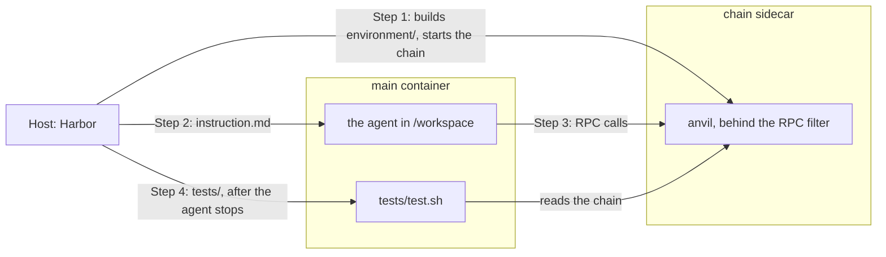

> **Agents:** read the [`create-task`](../.agents/skills/create-task/SKILL.md) and [`rewardkit`](../.agents/skills/rewardkit/SKILL.md) skills for Harbor's mechanics, then use this guide for our rules. The rest of the guide is for people.

# Introduction

## What is a task?

A task is an instruction for an agent or a bare model, plus the checks that decide whether it did it right.
You write the instruction, what the agent starts with, the checks, and a solution, all in one [Harbor](https://harborframework.com) task folder.

## The task folder

Every task belongs to one of three pillars: Concepts, Build, and Act.

- `concepts` holds quizzes.
- `build` holds builds.
- `act` holds tasks where the agent acts on a chain.

The pillar describes the work, not its tools. Start from the recipe with the same needs.

A task lives in `tasks/<pillar>/<task_name>/`:

```text
tasks/
└── <pillar>/
    └── <task_name>/
        ├── task.toml                 required: the name, description, modes, and how the verifier runs
        ├── README.md                 required: what the task touches and why it matters, for people
        ├── instruction.md            required: the message the agent or model gets
        ├── environment/              required: the agent's container and the files it starts with
        │   ├── Dockerfile
        │   ├── docker-compose.yaml   optional: sidecars the agent can call, like a chain
        │   ├── Chain.Dockerfile      required if there's a chain: the chain sidecar's image
        │   └── setup/                required if there's a chain: setup.s.sol, which prepares the chain before the agent starts
        ├── tests/                    required: test.sh and the checks
        └── solution/                 required: solve.sh, which proves every check can pass
```

Let's look at each piece:

### `task.toml`

`task.toml` holds the task's settings: its name, why it exists, the modes it runs in, and how Harbor runs its verifier. It takes these keys:

| Key                           | Required          | Holds                                                                     |
| ----------------------------- | ----------------- | ------------------------------------------------------------------------- |
| `schema_version`              | yes               | `"1.3"`, the version of Harbor's task format                              |
| `[task].name`                 | yes               | `buidlguidl/<task_name>`, the task's name everywhere it's published       |
| `[task].description`          | yes               | one line on why the task exists, shown on the website                     |
| `[task].authors`              | no                | who wrote it, like `[{ name = "BuidlGuidl" }]`                            |
| `[task].keywords`             | no                | a few words to find it by                                                 |
| `[metadata].pillar`           | yes               | the pillar, which must match the parent folder                            |
| `[metadata].area`             | no                | a non-empty string naming the part of dapp development, such as Lending or Swaps |
| `[metadata].layer`            | no                | for a Build task, what the agent writes: `contracts`, `frontend`, or `backend` |
| `[metadata].modes`            | yes               | any of `vanilla`, `internet`, and `skills`                                |
| `[verifier].environment_mode` | no                | `shared` for a task with a chain, `separate` for one without              |
| `[verifier].user`             | no                | `root` for Forge tests                                                    |
| `[verifier.env]`              | if it has criteria | the judge's key, and nothing else                                        |
| `artifacts`                   | if it's `separate` | the paths Harbor copies from the agent's container to the verifier       |
| `[environment]`               | no                | `cpus` and `memory_mb` for the agent's container                          |

`modes` picks how the task runs:

- `vanilla`: sends the instruction to a bare model in one API call, with no tools. Use it only for a question a bare model can answer in one reply.
- `internet`: runs an agent as it ships, with the web, a shell, its container, and the task's sidecars. Use it for work that needs an agent's tools or environment.
- `skills`: `internet` plus the [skills pack](../skills/README.md). List it with `internet` for any agent task.

Leave out what the board decides.
Which agents run, how many trials each gets (`n_attempts`), and how many retries a trial gets after an error all live in the board's [job config](../runner/ethevals/job.yaml).
The board sets no time limit of its own, so Harbor's defaults apply. The agent has none, and the verifier gets 10 minutes.
Add `[agent].timeout_sec` or `[verifier].timeout_sec` only when your task needs a different one.

### `README.md`

`README.md` tells people why the task exists and what it catches.
Harbor Hub and the Hugging Face dataset publish it with the task, and the agent never sees it.
Use these sections, in this order:

| Section               | Holds                                                                         |
| --------------------- | ----------------------------------------------------------------------------- |
| `# <title>`           | two or three sentences on what the user asks and what the task checks        |
| `## The instruction`  | `instruction.md`, word for word, as a blockquote so it wraps on GitHub: every line starts with `> `, and a `>` line separates paragraphs |
| `## What it touches`  | the areas the task touches, and the gotchas in each that the instruction leaves out |
| `## The checks`       | a table with every check by name, what it proves, and its area                |
| `## Why it matters`   | where the same gotchas hurt real projects, with links                         |
| `## Notes`            | optional caveats, such as a known contract that passes every check            |

In the blockquote, start every line with `> ` and put a lone `>` line between paragraphs.
A unit test fails the pull request if a section is missing, if the quoted instruction differs from `instruction.md`, or if the table leaves out a check.
Write the README before the tests.
If you can't name a gotcha that the instruction leaves out, the task probably won't tell agents apart.
The [token governor README](../tasks/build/token-governor/README.md) is a full example.

### `instruction.md`

`instruction.md` is the message the agent or model gets, word for word.

Write it the way a real person would send it. The board measures ordinary work, and an agent that knows how it's being checked can act differently.
So keep the tests, the target, the criteria, and the solution out of it, and out of the files the agent starts with.
Lint fails if `instruction.md` or any file under `environment/` uses words like eval, benchmark, rubric, grader, score, or epoch.

If the tests import the agent's code, name the file, the contract, and the constructor, so the tests can find them.
If the agent needs something setup made, like a wallet or a contract address, point it at `chain_context.json`.

### `environment/`

`environment/` builds the container the agent works in. Harbor calls it `main`.

**Dockerfile.** Start from one of our shared images, pinned by tag:

- `ghcr.io/buidlguidl/ethevals-quiz` for a quiz.
- `ghcr.io/buidlguidl/ethevals-chain` for everything else. It has Foundry, Solidity 0.8.30, and forge-std.

Both have RewardKit and the helpers the tests use. Copy the pin from one of the recipes. Lint fails if a pin doesn't match the image's build inputs.

The chain image starts a chain by default. When the agent's container is built on it, its Dockerfile clears that with `ENTRYPOINT []` and keeps the container running with `CMD ["sleep", "infinity"]`, as the recipes do.

**Starting files.** Put the files the agent starts with next to the Dockerfile, and `COPY` them into `/workspace`, like a Foundry project to build on.
Keep them as plain files. Lint refuses symlinks anywhere in the task folder.

Keep the task's own facts and setup inside its folder, not in the shared images.
Anyone can run the published folder with plain Harbor and no ETH Evals code, and it must behave as it does on the board.
So a task can't rely on changes to the runner.

**Sidecars.** Declare containers that run next to the agent's, like a chain, in `environment/docker-compose.yaml`.
Declare only the ones the task needs.
Compose names the agent's container `main`.
Lint allows a short list of compose options: no host mounts, no host network, no privileged containers, and every build stays inside the task folder.

For a chain, copy `Chain.Dockerfile` and `docker-compose.yaml` from the [mainnet fork recipe](#task-on-a-mainnet-fork), and leave out the chain's `environment:` block for a fresh chain.
The chain sidecar starts anvil, runs your setup, and only then lets the agent start.
The agent reaches it at `http://chain:8545`, through a filter that refuses anvil's cheat methods, like `anvil_setBalance`, and methods that ask the chain to sign, like `eth_sendTransaction`.
So the agent signs its own transactions, as it would on a real network.

**Secrets.** Keep credential values out of task files.
When a sidecar needs one, like a fork's RPC URL, compose takes it from the host as `${VAR:?message}`, and stops with your message if it's missing.
Give it only to the sidecar that needs it.
Don't put it in `[environment.env]` in `task.toml`, because Harbor can pass that into the agent's container.
A task can't ask for the board's own credentials, like the model keys.

### `environment/setup/`

`setup/` runs in the chain sidecar before the agent starts, and prepares the chain. For example, it can make the wallet the agent uses, fund it, or deploy the contracts the task asks about. The agent never sees it.

Setup scripts are Solidity files, `setup/setup.s.sol`, and the chain runs them with `forge script`. So you can use anything Foundry gives you, and call anvil methods through `vm.rpc`.

Your script extends our `ChainSetup` helper, which gives you these functions:

- `fund(addr, amount)`: sets the ETH balance of `addr`.
- `chainRecord(name, value)`: adds a field to `chain_context.json`, which the agent and the tests read.
- `privateRecord(name, value)`: adds a field to `private_chain_context.json`, which only the tests read.

Both record functions take an address, a `uint256`, a `bytes32`, or a string.
`ChainSetup` writes `rpcUrl` and `chainId` into `chain_context.json` for you.
Setup runs again for every trial, so you don't have to fix contract addresses or the agent's wallet ahead of time.

Here's where each file lands:

| File                         | The agent reads it at                                                                   | The tests read it at                                                          |
| ---------------------------- | --------------------------------------------------------------------------------------- | ----------------------------------------------------------------------------- |
| `chain_context.json`         | `/workspace/chain_context.json`, read-only, through a link the task's Dockerfile makes | `/chain/chain_context.json`, or `chain_context.json` in Forge                 |
| `private_chain_context.json` | never, because only root can open its folder                                            | `/private/private_chain_context.json`, or `private_chain_context.json` in Forge |

The recipes below show two real setups.

### `tests/`

`tests/` holds the checks that decide whether the agent got it right.
Harbor copies it in only after the agent stops, and runs `tests/test.sh`.

A check is one pass-or-fail result with a name and a one-line reason. A trial passes only if every check passes.
Check the outcome the instruction asked for, and give every failure a reason that says what went wrong.
Split separate requirements into separate checks, so a failure tells readers which one broke.
You pick the checks that fit your task, and you can use more than one kind:

| File                                                | Checks                                           |
| --------------------------------------------------- | ------------------------------------------------ |
| a Python file that calls `rk.final_answer`          | the final reply, against a target                |
| `tests/*.t.sol`                                     | the chain, the agent's code, or both, with Forge |
| a RewardKit judge file, like `tests/judge.toml`     | the trajectory, with criteria a judge answers    |

**Target.** For a quiz, you write a rule that accepts the right reply, and the check runs it on the agent's final reply.
A rule fits a fixed-form answer: yes or no, a number, an address, an exact string, or a name.
When the model explains the answer in its own words, a rule fails right replies, so a judge grades the final reply instead ([ADR 0016](adr/0016-quizzes-with-explained-answers-use-a-judge.md)). [`wallet-atomic-ready`](../tasks/concepts/wallet-atomic-ready) is the example, with its hand cases in `tests/hand-cases.json`.

<details>
<summary>Example target</summary>

```python
import string
import sys

sys.path.insert(0, "/opt")  # (1)
import target_checks
import rewardkit as rk

rk.final_answer(
    lambda reply: reply.strip(string.whitespace + string.punctuation).endswith("8004"),  # (2)
    name="erc_number",  # (3)
)
```

1. The quiz image keeps `target_checks.py` in `/opt`. Importing it adds `rk.final_answer`.
2. The rule gets the final reply and returns true or false. This one trims spaces and punctuation, then wants `8004` at the end, so `8004`, `ERC-8004`, and `It's ERC-8004.` all pass.
3. The check's name.

A wrong reply fails with the reason `Answer does not match the target.`, and an empty one with `The answer is empty.`
The reply comes from the agent's trajectory, `/logs/agent/trajectory.json`.

</details>

**Forge tests.** Each test function is one check. Tests can read the chain, import the agent's code, or both.

<details>
<summary>Example test</summary>

```solidity
    function test_recipient_balance() public view {  // (1)
        assertEq(token.balanceOf(recipient), 12_500_000, "recipient holds 12.5 tokens in base units");  // (2)
    }
```

1. The function name is the check's name.
2. If the assertion fails, its message becomes the reason, like `recipient holds 12.5 tokens in base units: 1250000 != 12500000`.

`tests/test.sh` runs them:

```sh
#!/bin/sh
set -eu
python3 /opt/forge_checks.py  # (1)
cp /opt/check_records.py /tests/check_records.py  # (2)
rewardkit /tests  # (3)
```

1. Copies the agent's files and your tests into a fresh Forge project, runs `forge test`, and writes one record for each test. It adds a `compile` check, and if that fails, every test fails with it.
2. Puts our shared check next to your tests. It turns each record into a check with its reason.
3. RewardKit runs every check in `tests/` and writes the reward.

</details>

**Other test tools.** Any tool can feed the same checks. It ships in your task's image, runs from `test.sh` before RewardKit, and writes `/logs/verifier/checks.json`, with one record for each check:

```json
{"check_name": {"passed": true, "reason": "A one-line reason."}}
```

Read [Verifiers](../runner/README.md#verifiers) before you add one.

**Criteria.** A judge answers yes-or-no questions about what only the trajectory shows, like whether the agent checked its work. Use criteria only for what no test can check. Each criterion is one check.

<details>
<summary>Example criteria</summary>

```toml
[judge]
judge = "anthropic/claude-opus-5-5"  # (1)
reasoning_effort = "high"
atif-trajectory = "/logs/agent/trajectory.json"  # (2)
guard = "flag"  # (3)

[scoring]
aggregation = "all-pass"  # (4)

[[criterion]]
name = "verified_transfer"  # (5)
type = "binary"
description = "Before reporting success, did the agent confirm on-chain that the transfer landed, for example by reading the transaction receipt or the recipient's token balance?"  # (6)
```

1. The judge for a plain Harbor run. The board sets one judge model and effort for every task.
2. The judge reads the agent's trajectory.
3. Reports any instructions the agent wrote for the judge.
4. Every criterion must pass.
5. The check's name.
6. The question. The judge answers yes or no and writes the reason.

</details>

Lint checks every judge file against the board's rules:

- Every criterion is yes-or-no, with its own name.
- The judge reads `/logs/agent/trajectory.json`, or only plain-text files under `/logs/verifier/` without a trajectory, such as a quiz's final reply, `/logs/verifier/final-reply.txt`.
- Its guard is `flag` or `penalize`.
- Every criterion counts toward `all-pass`.

The judge needs an API key. A task with criteria declares exactly this in `task.toml`, and no other credential:

```toml
[verifier.env]
ANTHROPIC_API_KEY = "${ANTHROPIC_API_KEY}"
```

The free check can't run the judge, because that's a paid call. So read each question yourself, and make sure the trajectory can answer it. Reviewers check this too.

**`reward.toml`.** Every task has a `tests/reward.toml` that makes the reward 1 only when every check passes:

```toml
[scoring.check_records]  # (1)
aggregation = "all-pass"

[[reward]]
name = "reward"  # (2)
aggregation = "all-pass"
```

1. The checks from `check_records.py`. A quiz names its own file instead, like `[scoring.answer]` for `answer.py`.
2. The trial's reward. A trial passes when it's 1.

RewardKit writes `reward.json` and `reward-details.json` to `/logs/verifier/`. The board reads each check and its reason from `reward-details.json`.

### `solution/`

`solution/solve.sh` is a working answer. Harbor's oracle agent runs it in place of an agent, to prove every check can pass.
It runs in the agent's container, so it uses only what the agent gets: the instruction, the starting files, and `chain_context.json`.
Put any files it needs next to it. Harbor copies `solution/` to `/solution`.

A quiz or a task with criteria also needs a trajectory, which the oracle agent doesn't write.
So its solution writes a stand-in to `/logs/agent/trajectory.json`, in Harbor's ATIF format.

We publish every task's files, solutions included, in our [Hugging Face dataset](https://huggingface.co/datasets/buidlguidl/ethevals-test).
Training on them is welcome, but the board can't tell a learned answer from new work.

### How a trial runs

A trial is one agent or model doing a task once, in one mode. Here is a trial of a task with a chain:



1. Harbor builds `environment/` and starts the chain sidecar. The sidecar runs `setup/setup.s.sol`, which writes `chain_context.json` and `private_chain_context.json`.
2. Once setup is done, Harbor starts the agent in `main` and sends it `instruction.md`.
3. The agent works in `/workspace` and talks to the chain over RPC. It never sees `tests/`, `solution/`, or `private_chain_context.json`.
4. When the agent stops, Harbor copies `tests/` into `main` and runs `test.sh` as root. The tests read both context files and the chain as the agent left it, and the judge reads the trajectory. RewardKit writes the reward.

A task without a chain has no sidecar, and its verifier is `separate`.
When the agent stops, Harbor saves the paths in `artifacts` and stops `main`.
Then it starts a fresh container from the same image, copies those paths back in, and runs `tests/` there.
In the `vanilla` mode, our one-call agent sends the instruction to the bare model and saves its reply as the trajectory.

## Recipes

Start from the recipe closest to your task. Each one is a real task, and the free check keeps it working.

### Simple quiz

This recipe checks the reply against a target.
It's [`tasks/concepts/agent-registries`](../tasks/concepts/agent-registries).

```text
agent-registries/
├── task.toml
├── README.md
├── instruction.md
├── environment/
│   └── Dockerfile
├── tests/
│   ├── test.sh
│   ├── reward.toml
│   └── answer.py
└── solution/
    └── solve.sh
```

```toml
schema_version = "1.3"
artifacts = ["/logs/agent/trajectory.json"]  # (1)

[task]
name = "buidlguidl/agent-registries"
description = "Check whether a model knows the ERC that gives AI agents onchain identity, reputation, and validation registries."  # (2)
authors = [{ name = "BuidlGuidl" }]
keywords = ["ethereum", "erc", "agent-discovery"]

[metadata]
pillar = "concepts"
modes = ["vanilla", "internet", "skills"]  # (3)

[verifier]
environment_mode = "separate"  # (4)

[environment]
cpus = 1
memory_mb = 1024
```

1. Copies the agent's trajectory to the verifier, which reads the final reply from it.
2. The website shows it. The agent never sees it.
3. A quiz needs no tools, so it can run in `vanilla`.
4. There's no chain to read, so the verifier checks the reply in a fresh container.

`instruction.md` asks the way a person would:

```text
Which ERC defines onchain identity, reputation and validation registries for AI agents? Answer with the ERC number only.
```

<details>
<summary><code>environment/Dockerfile</code></summary>

```dockerfile
FROM ghcr.io/buidlguidl/ethevals-quiz:inputs-477f6b3f35664858
```

The quiz image has RewardKit and the target helper. A quiz needs nothing else.

</details>

`tests/answer.py` is the [target example](#tests) above.

<details>
<summary><code>tests/test.sh</code> and <code>tests/reward.toml</code></summary>

```sh
#!/bin/sh
set -eu
rewardkit /tests
```

A quiz has no test tool, so `test.sh` only runs RewardKit.

```toml
[scoring.answer]  # (1)
aggregation = "all-pass"

[[reward]]
name = "reward"
aggregation = "all-pass"
```

1. The checks in `answer.py`.

</details>

<details>
<summary><code>solution/solve.sh</code></summary>

```sh
#!/bin/sh
set -eu
mkdir -p /logs/agent
cat > /logs/agent/trajectory.json <<'EOF'
{
  "schema_version": "ATIF-v1.7",
  "session_id": "solution",
  "agent": {"name": "oracle", "version": "1.0.0"},
  "steps": [{"step_id": 1, "source": "agent", "message": "8004"}]
}
EOF
```

The oracle agent gives no reply, so the solution writes a one-step trajectory whose last message is the answer.

</details>

To prove the target catches a wrong answer, change `"8004"` in `solve.sh` to `"8005"` and run the [free check](#check-your-task).
The oracle run now fails, and its `reward-details.json` gives the reason `Answer does not match the target.` Change it back.

### Task with a fresh chain

This recipe checks a page the agent builds against a chain that starts empty.
Setup deploys a governor and seeds its proposals, the agent adds a voting page, a browser drives the page with a wallet, and criteria ask whether the page showed what the governor says.
It's [`tasks/build/voting-page`](../tasks/build/voting-page).

```text
voting-page/
├── task.toml
├── README.md
├── instruction.md
├── environment/
│   ├── Dockerfile
│   ├── Chain.Dockerfile
│   ├── docker-compose.yaml
│   ├── contracts/          the contracts setup deploys
│   ├── starter/            the create-wagmi project the agent starts with
│   ├── verifier/           the browser's packages, for the tests
│   └── setup/
│       ├── setup.s.sol
│       ├── start.py
│       ├── seed.py
│       └── bin/
│           └── anvil
├── tests/
│   ├── test.sh
│   ├── reward.toml
│   ├── judge.toml
│   ├── check_records.py
│   ├── run_reward.py
│   ├── browser.mjs         drives the page, with help from the other .mjs files
│   └── ...
└── solution/
    ├── solve.sh
    └── app/
```

<details>
<summary><code>task.toml</code></summary>

```toml
schema_version = "1.3"
artifacts = [{ source = "/workspace", exclude = ["node_modules", "dist", ".git", "chain_context.json"] }]  # (1)

[task]
name = "buidlguidl/voting-page"
description = "Build a holder voting page that follows proposal state, quorum, deadlines, and snapshot voting power."
authors = [{ name = "BuidlGuidl" }]
keywords = ["ethereum", "governance", "react", "wagmi", "anvil"]

[metadata]
pillar = "build"
modes = ["internet", "skills"]  # (2)

[verifier]
environment_mode = "shared"  # (3)
user = "root"  # (4)
timeout_sec = 1800  # (5)

[verifier.env]
ANTHROPIC_API_KEY = "${ANTHROPIC_API_KEY}"  # (6)

[environment]
cpus = 1
memory_mb = 4096
```

1. Saves the agent's project with the trial, without its packages and build output.
2. A bare model can't build a page, so no `vanilla`.
3. The tests run in the agent's container, while the chain is still up.
4. The tests stop the agent's processes and build the page as `agent`, which takes root.
5. Building the page and driving it takes longer than the verifier's 10-minute default.
6. The judge's key, for the criteria.

</details>

`instruction.md` is one line:

> Tally is gone, and our holders need our own voting page. The governor, its timelock and the vote token are already deployed (the addresses are in chain_context.json), and TOKEN is the token holders own. Could you add a Governance page to this project where a connected holder can wrap TOKEN into votes, delegate them and see how many votes they have, see every proposal with its status, the votes for and against, whether it has reached quorum and when voting ends, and vote on the open ones? It's just for holders; the team queues and executes from our safe.

<details>
<summary><code>environment/Dockerfile</code> and <code>environment/Chain.Dockerfile</code></summary>

The chain sidecar:

```dockerfile
FROM ghcr.io/buidlguidl/ethevals-chain:inputs-d0ef1955a98ec678 AS contracts
USER root
WORKDIR /opt/governance
COPY contracts/ ./
RUN git clone --depth 1 --branch v5.7.0 https://github.com/OpenZeppelin/openzeppelin-contracts.git lib/openzeppelin-contracts && \
    test "$(git -C lib/openzeppelin-contracts rev-parse HEAD)" = cab19933c33c2ad1d4c7a84864a3601dddfd16f3 && \
    ln -s /opt/solidity/lib/forge-std lib/forge-std && \
    forge build && python3 export.py
COPY setup/ /setup/
RUN chmod +x /setup/bin/anvil
WORKDIR /tmp
ENTRYPOINT ["python3", "/setup/start.py"]
```

The first stage builds the contracts in `contracts/` with OpenZeppelin 5.7.0, pinned to one commit, so setup can deploy them.
Only the sidecar gets `setup/`.
It starts this task's `start.py` in place of the shared starter, `start_chain.py`.

The agent's container starts with the same contracts stage, then adds Node.js, pnpm, and a browser that only root can use, for the tests. It ends like this:

```dockerfile
USER agent
COPY --chown=agent:agent starter/package.json starter/pnpm-lock.yaml starter/.npmrc ./
RUN pnpm install --frozen-lockfile && rm -rf /home/agent/.local/share/pnpm/store
COPY --chown=agent:agent starter/ ./
COPY --from=contracts --chown=agent:agent /opt/governance/frontend/ /workspace/contracts/
RUN ln -s /chain/chain_context.json /workspace/chain_context.json
ENTRYPOINT []
CMD ["sleep", "infinity"]
```

The agent starts with the starter project, its packages installed, and the contracts' sources and ABIs in `contracts/`.
The link puts `chain_context.json` in the agent's folder. The image makes the link, so the task folder has no symlink.
[The full file](../tasks/build/voting-page/environment/Dockerfile) has the rest.

</details>

<details>
<summary><code>environment/docker-compose.yaml</code></summary>

```yaml
services:
  main:  # (1)
    build:
      context: .
      dockerfile: Dockerfile
    user: agent  # (2)
    volumes:
      - public-context:/chain:ro  # (3)
    depends_on:
      chain:
        condition: service_healthy  # (4)
  chain:  # (5)
    build:
      context: .
      dockerfile: Chain.Dockerfile
    mem_limit: 3g
    volumes:
      - public-context:/chain
      - private-context:/private
    healthcheck:
      test: [CMD-SHELL, "test -f /tmp/voting-ready && cast chain-id --rpc-url http://127.0.0.1:8545"]  # (6)
      interval: 1s
      timeout: 3s
      retries: 600
volumes:
  public-context: {}
  private-context: {}
```

1. The agent's container.
2. The agent runs as `agent`.
3. Setup's public file arrives read-only. The tests read nothing private, so `main` doesn't mount `/private`.
4. The agent starts only after setup is done.
5. The chain sidecar. The agent reaches it at `http://chain:8545`.
6. Passes once `start.py` has seeded the chain. A chain set up only by `setup.s.sol` waits for `/tmp/chain-ready`, which the shared starter writes.

</details>

<details>
<summary><code>environment/setup/</code></summary>

`setup.s.sol` runs first, as in any chain task:

```solidity
// SPDX-License-Identifier: MIT
pragma solidity 0.8.30;

import {ChainSetup} from "ethevals/ChainSetup.sol";  // (1)

contract Setup is ChainSetup {
    function run() external {
        vm.rpc("anvil_setBlockTimestampInterval", "[12]");  // (2)
    }
}
```

1. Gives you `fund`, `chainRecord`, and `privateRecord`. This task uses none of them.
2. Setup can call anvil methods through `vm.rpc`, and the agent can't, because the filter refuses them. This one puts 12 seconds between blocks.

`start.py` runs the shared starter, then seeds the chain before the healthcheck passes:

```python
def main():
    environment = dict(os.environ, PATH="/setup/bin:" + os.environ["PATH"])  # (1)
    process = subprocess.Popen([sys.executable, "/opt/start_chain.py"], env=environment)  # (2)
    try:
        deadline = time.monotonic() + 600
        while not Path("/tmp/chain-ready").exists():  # (3)
            if process.poll() is not None:
                raise RuntimeError("The shared chain starter exited.")
            if time.monotonic() >= deadline:
                raise TimeoutError("The shared chain starter exceeded ten minutes.")
            time.sleep(0.1)
        subprocess.run([sys.executable, "/setup/seed.py", "seed", "--rpc-url", "http://127.0.0.1:8546",
                        "--contracts", "/opt/governance"], check=True, timeout=max(1, deadline - time.monotonic()))  # (4)
        states("http://127.0.0.1:8546", Path("/private/private_chain_context.json"))
        Path("/tmp/voting-ready").touch()  # (5)
        process.wait()
        raise RuntimeError("The shared chain starter exited.")
    finally:
        process.terminate()
```

1. Puts this task's `bin/anvil` first on the path. It starts anvil with its clock in the past.
2. The shared starter starts anvil behind the RPC filter and runs `setup.s.sol`.
3. The shared starter writes `/tmp/chain-ready` once setup is done.
4. Seeds the chain on port 8546, where anvil listens inside the sidecar. The agent reaches only the filter, on 8545.
5. Releases the healthcheck.

[`seed.py`](../tasks/build/voting-page/environment/setup/seed.py) makes five random wallets, deploys the contracts, has four holders wrap and delegate TOKEN, and seeds five proposals in different states.
Then it writes both context files itself:

```python
    context = dict(rpcUrl="http://chain:8545", chainId=31337, token=token, voteToken=votes, governor=governor, timelock=timelock)  # (1)
    private_context = dict(deployer=deployer, holders=holders, protocol=protocol, proposals={})  # (2)
    seed_proposals(url, context, private_context, checks=False)
    private_context["setupBlock"] = int(rpc(url, "eth_blockNumber"), 16)
    write_json(public / "chain_context.json", context, 0o444)
    write_json(private / "private_chain_context.json", private_context, 0o400)
```

1. What the agent gets: the RPC URL, the chain ID, and the contracts' addresses.
2. The wallets' keys go only to the private chain context.

</details>

<details>
<summary><code>tests/test.sh</code> and <code>tests/judge.toml</code></summary>

`test.sh` stops the agent's processes and builds the page as `agent`, with no model keys.
It writes the `compile` check to `/logs/verifier/checks.json`, the file any [other test tool](#tests) writes. Then it drives the page:

```sh
export PLAYWRIGHT_BROWSERS_PATH=/root/voting-browsers
browser_status=0
env -u ANTHROPIC_API_KEY -u OPENAI_API_KEY -u OPENROUTER_API_KEY -u ANTHROPIC_AUTH_TOKEN -u EXA_API_KEY \
  node /tests/browser.mjs /workspace /logs/verifier > /logs/verifier/browser.log 2>&1 || browser_status=$?  # (1)
python3 /tests/run_reward.py  # (2)
```

1. `browser.mjs` forks the chain, adds ten test proposals the agent never saw, and opens the page with an injected wallet. It adds a record to `checks.json` for each check, and saves the page's text to `page-evidence.txt` for the judge.
2. Runs RewardKit. `check_records.py` turns each record into a check, and the judge answers the criteria. If the browser couldn't finish a flow and no check failed, the trial is an error for a person to look at.

`judge.toml` starts like this:

```toml
[judge]
judge = "anthropic/claude-opus-5-5"
reasoning_effort = "high"
guard = "flag"
files = ["/logs/verifier/page-evidence.txt"]  # (1)

[scoring]
aggregation = "all-pass"
```

1. The judge reads only the page text the tests saved, not the agent's code or trajectory.

Six criteria follow, one for each code check that captures the page. For example, `shown_for_only_quorum` asks whether each proposal shows quorum as reached only when its For votes reach it.
[The full file](../tasks/build/voting-page/tests/judge.toml) has them all.
`tests/reward.toml` is the same as in [`tests/`](#tests).

</details>

<details>
<summary><code>solution/solve.sh</code></summary>

```sh
#!/bin/sh
set -eu
cp -R /solution/app/. /workspace/
```

`solve.sh` copies a working page over the starter, where the agent would build it.
See [the page](../tasks/build/voting-page/solution/app/src/App.tsx).

</details>

The free check skips the criteria, so it runs only the code checks.
To prove they catch a wrong page, change `setRows(proposals.reverse())` to `setRows(proposals.reverse().slice(0, 10))` in `solution/app/src/App.tsx` and run the [free check](#check-your-task).
The oracle run now fails `lists_every_proposal` and `status_and_tallies_match`, because the page shows only the newest ten proposals.
The first gives the reason `The fork has 15 proposals; the page lists 10. See initial-page.txt.` Change it back.

### Task on a mainnet fork

To check against a live protocol, the chain sidecar forks mainnet at a pinned block.
This recipe has the agent take a Morpho Vaults V2 vault out of one market for good. Setup makes the agent's wallet the vault's curator and an allocator, and leaves two cap raises pending. Forge tests read the vault and try it as a stranger and as a depositor.
It's [`tasks/act/vault-v2-market-exit`](../tasks/act/vault-v2-market-exit).

```text
vault-v2-market-exit/
├── task.toml
├── README.md
├── instruction.md
├── environment/
│   ├── Dockerfile
│   ├── Chain.Dockerfile
│   ├── docker-compose.yaml
│   └── setup/
│       └── setup.s.sol
├── tests/
│   ├── test.sh
│   ├── reward.toml
│   └── Exit.t.sol
└── solution/
    └── solve.sh
```

It has no criteria and no seeding script. The fork lives in the chain sidecar's part of `docker-compose.yaml`:

```yaml
    environment:
      FORK_RPC_URL: ${MAINNET_RPC_URL:?MAINNET_RPC_URL is required}  # (1)
      FORK_BLOCK_NUMBER: "26256000"  # (2)
```

1. The RPC URL comes from the host and reaches only the chain sidecar. Compose stops with this message if it's missing.
2. Pins the block, so every trial starts from the same state.

`instruction.md` is one line:

> we curate a morpho vaults v2 vault, and one of its markets has an oracle we no longer trust after yesterday's incident. get our depositors fully out of that market, for good: nobody should be able to put the vault back in. move the funds to the other markets or leave them idle, your call. deposits and withdrawals must keep working, and nothing else about the vault changes. the vault, the market id and our wallet are in chain_context.json; the wallet holds the curator and allocator roles. do it on that chain and tell us what you did.

<details>
<summary><code>task.toml</code></summary>

```toml
schema_version = "1.3"

[task]
name = "buidlguidl/vault-v2-market-exit"
description = "Check whether an agent exits a Morpho V2 market, cancels pending cap raises, and preserves deposits and withdrawals."
authors = [{ name = "BuidlGuidl" }]
keywords = ["ethereum", "morpho", "vault", "fork"]

[metadata]
pillar = "act"
modes = ["internet", "skills"]  # (1)

[verifier]
environment_mode = "shared"  # (2)
user = "root"  # (3)

[environment]
cpus = 1
memory_mb = 4096
```

1. A bare model can't send a transaction, so no `vanilla`.
2. The tests run in the agent's container, while the chain is still up.
3. Only root can read `private_chain_context.json`.

</details>

<details>
<summary><code>environment/Dockerfile</code> and <code>environment/Chain.Dockerfile</code></summary>

The agent's container:

```dockerfile
FROM ghcr.io/buidlguidl/ethevals-chain:inputs-d0ef1955a98ec678
WORKDIR /workspace
RUN ln -s /chain/chain_context.json /workspace/chain_context.json
ENTRYPOINT []
CMD ["sleep", "infinity"]
```

The link puts `chain_context.json` in the agent's folder. The image makes the link, so the task folder has no symlink.

The chain sidecar:

```dockerfile
FROM ghcr.io/buidlguidl/ethevals-chain:inputs-d0ef1955a98ec678
USER root
COPY setup/ /setup/
RUN mkdir -p setup && cp /setup/*.sol setup/ && \
    cp /opt/setup-foundry.toml foundry.toml && \
    forge build && rm -rf setup
ENTRYPOINT ["python3", "/opt/start_chain.py"]
```

Only the sidecar gets `setup/`. The `RUN` line compiles setup while the image builds. `start_chain.py` starts anvil behind the RPC filter, runs setup, and writes both context files.

</details>

<details>
<summary><code>environment/docker-compose.yaml</code></summary>

```yaml
services:
  main:  # (1)
    build:
      context: .
      dockerfile: Dockerfile
    user: agent  # (2)
    volumes:
      - public-context:/chain:ro  # (3)
      - private-context:/private:ro
    depends_on:
      chain:
        condition: service_healthy  # (4)
  chain:  # (5)
    build:
      context: .
      dockerfile: Chain.Dockerfile
    environment:
      FORK_RPC_URL: ${MAINNET_RPC_URL:?MAINNET_RPC_URL is required}
      FORK_BLOCK_NUMBER: "26256000"
    mem_limit: 3g
    volumes:
      - public-context:/chain
      - private-context:/private
    healthcheck:
      test: [CMD-SHELL, "test -f /tmp/chain-ready && cast chain-id --rpc-url http://127.0.0.1:8545"]  # (6)
      interval: 1s
      timeout: 3s
      retries: 180
volumes:
  public-context: {}
  private-context: {}
```

1. The agent's container.
2. The agent runs as `agent`, so it can't open `/private`.
3. Setup's files arrive read-only.
4. The agent starts only after setup is done.
5. The chain sidecar. The agent reaches it at `http://chain:8545`.
6. Passes once setup has written both context files.

</details>

<details>
<summary><code>environment/setup/setup.s.sol</code></summary>

`run()` makes the agent's wallet and hands it the vault:

```solidity
        Vm.Wallet memory wallet = vm.createWallet(vm.randomUint(1, SECP256K1_ORDER - 1));  // (1)
        fund(wallet.addr, 10 ether);
        address owner = VAULT.owner();  // (2)
        address curator = VAULT.curator();
        MarketParams memory params = MORPHO.idToMarketParams(MARKET);
        bytes memory idData = abi.encode("this/marketParams", address(ADAPTER), params);
        bytes32 id = keccak256(idData);
        bytes memory absoluteRaise = abi.encodeCall(IVaultSetup.increaseAbsoluteCap, (idData, VAULT.absoluteCap(id) * 2));
        bytes memory relativeRaise = abi.encodeCall(IVaultSetup.increaseRelativeCap, (idData, uint256(1e18)));
        require(VAULT.timelock(IVaultSetup.setIsAllocator.selector) == 0, "allocator appointment has a delay");

        makeLiquid(params);
        start(curator);  // (3)
        send(curator, address(VAULT), abi.encodeCall(IVaultSetup.submit, (absoluteRaise)));  // (4)
        send(curator, address(VAULT), abi.encodeCall(IVaultSetup.submit, (relativeRaise)));
        stop(curator);
        start(owner);
        send(owner, address(VAULT), abi.encodeCall(IVaultSetup.setCurator, (wallet.addr)));  // (5)
        stop(owner);
        start(wallet.addr);
        bytes memory allocator = abi.encodeCall(IVaultSetup.setIsAllocator, (wallet.addr, true));
        send(wallet.addr, address(VAULT), abi.encodeCall(IVaultSetup.submit, (allocator)));
        send(wallet.addr, address(VAULT), allocator);  // (6)
        stop(wallet.addr);
```

1. Makes a new random wallet for each trial, with ETH for gas.
2. Setup reads the live vault at the pinned block.
3. Acts as the vault's real curator. `start` and `stop` are below.
4. The curator submits two cap raises for the market. They wait out the vault's timelock, so they're still pending when the agent starts.
5. The owner makes the agent's wallet the curator.
6. The wallet makes itself an allocator, which has no timelock on this vault.

Then it records what the tests and the agent need:

```solidity
        privateRecord("absoluteRaise", vm.toString(absoluteRaise));  // (1)
        privateRecord("relativeRaise", vm.toString(relativeRaise));
        privateRecord("absoluteMaturity", VAULT.executableAt(absoluteRaise));
        privateRecord("relativeMaturity", VAULT.executableAt(relativeRaise));
        privateRecord("adapter", address(ADAPTER));
        privateRecord("totalAssets", VAULT.totalAssets());
        privateRecord("totalSupply", VAULT.totalSupply());
        privateRecord("liquidityAdapter", VAULT.liquidityAdapter());
        privateRecord("liquidityData", vm.toString(VAULT.liquidityData()));
        privateRecord("sender", wallet.addr);
        privateRecord("setupBlock", block.number);
        recordMarkets();
        recordSettings(owner, curator, wallet.addr);  // (2)
        chainRecord("vault", address(VAULT));  // (3)
        chainRecord("marketId", MARKET);
        chainRecord("wallet", wallet.addr);
        chainRecord("privateKey", bytes32(wallet.privateKey));
```

1. Adds fields to `private_chain_context.json`, for the tests: the pending raises and the vault before the agent starts.
2. Records every other setting, so the tests can check that nothing else changed.
3. Adds fields to `chain_context.json`: the vault, the market, and the wallet's key.

The helpers send transactions as any account:

```solidity
    function start(address account) internal {
        fund(account, 10 ether);
        vm.rpc("anvil_impersonateAccount", string.concat('["', vm.toString(account), '"]'));  // (1)
    }

    function stop(address account) internal {
        vm.rpc("anvil_stopImpersonatingAccount", string.concat('["', vm.toString(account), '"]'));
    }

    function send(address sender, address target, bytes memory data) internal {
        vm.rpc("eth_sendTransaction", string.concat(  // (2)
            '[{"from":"', vm.toString(sender), '","to":"', vm.toString(target),
            '","gas":"0x200000","data":"', vm.toString(data), '"}]'
        ));
        // The later fork must see this transaction in a mined block.
        vm.rpc("evm_mine", "[]");
    }
```

1. Setup can call anvil methods through `vm.rpc`. The agent can't, because the filter refuses them.
2. Sends a transaction from the account setup is acting as.

Setup also tops up the market so the vault can leave it, and records each market's assets and caps. [The full file](../tasks/act/vault-v2-market-exit/environment/setup/setup.s.sol) has them.

</details>

<details>
<summary><code>tests/Exit.t.sol</code></summary>

The file declares the interfaces it calls, then the checks:

```solidity
contract ExitCheck is Test {
    using stdJson for string;

    IMorpho constant MORPHO = IMorpho(0xBBBBBbbBBb9cC5e90e3b3Af64bdAF62C37EEFFCb);  // (1)
    IVault vault;
    IAdapter adapter;
    bytes32 marketId;
    bytes32 capId;
    MarketParams params;
    string beforeState;

    function setUp() public {
        string memory chain = vm.readFile("chain_context.json");  // (2)
        beforeState = vm.readFile("private_chain_context.json");  // (3)
        vm.createSelectFork("chain");  // (4)
        vault = IVault(chain.readAddress(".vault"));
        adapter = IAdapter(beforeState.readAddress(".adapter"));
        marketId = chain.readBytes32(".marketId");
        params = MORPHO.idToMarketParams(marketId);
        capId = keccak256(abi.encode("this/marketParams", address(adapter), params));
    }

    function test_vaultIsOutForGood() public {  // (5)
        assertOut();
        assertEq(vault.executableAt(beforeState.readBytes(".absoluteRaise")), 0, "absolute raise remains pending");  // (6)
        assertEq(vault.executableAt(beforeState.readBytes(".relativeRaise")), 0, "relative raise remains pending");
        if (vault.liquidityAdapter() == address(adapter)) {
            assertNotEq(keccak256(vault.liquidityData()), marketId, "liquidity route still uses the exit market");
        }
    }

    function test_strangerCannotReopenIt() public {
        assertOut();
        (uint256 exitShares,,) = MORPHO.position(marketId, address(adapter));
        uint256 absoluteMaturity = beforeState.readUint(".absoluteMaturity");
        uint256 relativeMaturity = beforeState.readUint(".relativeMaturity");
        uint256 maturity = absoluteMaturity > relativeMaturity ? absoluteMaturity : relativeMaturity;
        vm.warp((block.timestamp > maturity ? block.timestamp : maturity) + 1);  // (7)
        address stranger = makeAddr("stranger");
        vm.startPrank(stranger);
        (bool absoluteOk,) = address(vault).call(beforeState.readBytes(".absoluteRaise"));
        (bool relativeOk,) = address(vault).call(beforeState.readBytes(".relativeRaise"));
        vm.stopPrank();
        assertFalse(absoluteOk, "stranger executed the mature absolute raise");
        assertFalse(relativeOk, "stranger executed the mature relative raise");
        assertMarketClosed();
        (uint256 shares,,) = MORPHO.position(marketId, address(adapter));
        assertEq(shares, exitShares, "stranger added supply shares in the exit market");
    }
```

1. The tests can name live protocol contracts, because the chain is a fork.
2. Tests read `chain_context.json`.
3. And `private_chain_context.json`, which the agent never sees.
4. Forks the chain as the agent left it.
5. Each `test` function is one check.
6. The message is the reason when the check fails.
7. Moves past the raises' timelock on the test's own fork, then tries them as a stranger.

`test_depositorsStillServed` and `test_nothingElseChanged` follow, with the helpers they share. [The full file](../tasks/act/vault-v2-market-exit/tests/Exit.t.sol) has them all.
`tests/test.sh` and `tests/reward.toml` are the same as in [`tests/`](#tests).

</details>

<details>
<summary><code>solution/solve.sh</code></summary>

```sh
#!/bin/sh
set -eu
cd /workspace  # (1)
test -r chain_context.json  # (2)
test ! -r /private/private_chain_context.json  # (3)
context() {
    python3 -c 'import json, sys; print(json.load(open("chain_context.json"))[sys.argv[1]])' "$1"
}
rpc=$(context rpcUrl)
key=$(context privateKey)
vault=$(context vault)
market=$(context marketId)
morpho=0xBBBBBbbBBb9cC5e90e3b3Af64bdAF62C37EEFFCb
adapter=$(cast call "$vault" 'liquidityAdapter()(address)' --rpc-url "$rpc")
params=$(cast call "$morpho" 'idToMarketParams(bytes32)(address,address,address,address,uint256)' "$market" --rpc-url "$rpc" --json |
    python3 -c 'import json, sys; print("(" + ",".join(map(str, json.load(sys.stdin))) + ")")')
data=$(cast abi-encode 'f((address,address,address,address,uint256))' "$params")
id_data=$(cast abi-encode 'f(string,address,(address,address,address,address,uint256))' this/marketParams "$adapter" "$params")
send() {
    cast send "$vault" "$@" --private-key "$key" --rpc-url "$rpc" --json > /dev/null
}

# Submit events identify the exact calldata, including raises with different amounts.
topic=$(cast keccak 'Submit(bytes4,bytes,uint256)')
cast logs --address "$vault" --from-block 26256001 --to-block latest "$topic" --rpc-url "$rpc" --json |
    python3 -c 'import json, sys; [print(log["data"]) for log in json.load(sys.stdin)]' > /tmp/vault-submit-events
while IFS= read -r event_data; do
    pending=$(cast abi-decode 'f()(bytes,uint256)' "$event_data" --json |
        python3 -c 'import json, sys; print(json.load(sys.stdin)[0])')
    decoded=$(cast calldata-decode 'increaseAbsoluteCap(bytes,uint256)' "$pending" --json 2>/dev/null || true)
    if [ -z "$decoded" ]; then
        decoded=$(cast calldata-decode 'increaseRelativeCap(bytes,uint256)' "$pending" --json 2>/dev/null || true)
    fi
    if [ -z "$decoded" ]; then continue; fi
    pending_id=$(printf '%s' "$decoded" | python3 -c 'import json, sys; print(json.load(sys.stdin)[0])')
    if [ "$pending_id" != "$id_data" ]; then continue; fi
    executable=$(cast call "$vault" 'executableAt(bytes)(uint256)' "$pending" --rpc-url "$rpc" | awk '{print $1}')
    if [ "$executable" != 0 ]; then send 'revoke(bytes)' "$pending"; fi  # (4)
done < /tmp/vault-submit-events

send 'decreaseAbsoluteCap(bytes,uint256)' "$id_data" 0  # (5)
send 'decreaseRelativeCap(bytes,uint256)' "$id_data" 0

# An unset route serves deposits and withdrawals from idle assets.
send 'setLiquidityAdapterAndData(address,bytes)' 0x0000000000000000000000000000000000000000 0x  # (6)
pass=0
while [ "$pass" -lt 5 ]; do
    assets=$(cast call "$adapter" 'expectedSupplyAssets(bytes32)(uint256)' "$market" --rpc-url "$rpc" | awk '{print $1}')
    if [ "$assets" = 0 ]; then break; fi
    send 'deallocate(address,bytes,uint256)' "$adapter" "$data" "$assets"  # (7)
    pass=$((pass + 1))
done
test "$(cast call "$adapter" 'expectedSupplyAssets(bytes32)(uint256)' "$market" --rpc-url "$rpc" | awk '{print $1}')" = 0
echo 'Revoked pending raises, zeroed both market caps, removed the liquidity route, and moved the market assets to idle.'
```

1. Starts where the agent does.
2. Checks that it can read the chain context, like the agent.
3. Proves the agent can't read the private chain context.
4. Revokes each pending raise for the market, found from the vault's `Submit` events.
5. Sets both of the market's caps to zero.
6. Takes the market off the route that deposits and withdrawals use.
7. Moves the market's assets back to the vault as idle funds.

</details>

Set `MAINNET_RPC_URL` before you run the free check. Without it, the free check lints the task, skips its runs, and says so.
Pull request CI has no secrets, so it skips them too.
Instead, a maintainer runs the fork check by hand once they've reviewed your code, and it must pass before merge.
That keeps the RPC secret away from code nobody has reviewed.

To prove the tests catch a wrong answer, delete the line that sends `revoke(bytes)` from `solve.sh` and run the free check.
The oracle run now fails `test_vaultIsOutForGood` and `test_strangerCannotReopenIt`, because the raises stay pending. Change it back.

### Task that tests the agent's code

This recipe checks code the agent writes.
Forge tests run the agent's deploy script, then propose, vote, and execute through its governor.
It's [`tasks/build/token-governor`](../tasks/build/token-governor).

```text
token-governor/
├── task.toml
├── README.md
├── instruction.md
├── environment/
│   ├── Dockerfile
│   ├── foundry.toml
│   └── src/
│       ├── Protocol.sol
│       ├── Token.sol
│       └── interfaces/
│           └── IVoteToken.sol
├── tests/
│   ├── test.sh
│   ├── reward.toml
│   └── TokenGovernor.t.sol
└── solution/
    └── solve.sh
```

<details>
<summary><code>task.toml</code></summary>

```toml
schema_version = "1.3"
artifacts = ["/workspace"]  # (1)

[task]
name = "buidlguidl/token-governor"
description = "Check whether an agent puts a live token's treasury and protocol owner role under holder votes with the right quorum and execution wait."
authors = [{ name = "BuidlGuidl" }]
keywords = ["ethereum", "solidity", "governance"]

[metadata]
pillar = "build"
modes = ["internet", "skills"]

[verifier]
environment_mode = "separate"  # (2)
user = "root"

[environment]
cpus = 1
memory_mb = 2048
```

1. Copies the agent's project to the verifier.
2. There's no chain, so the tests run in a fresh container.

</details>

`instruction.md` names the files, the contract, and the deploy script's `run(token)`, because the tests import and run them:

```text
Our token TOKEN is live, a plain ERC-20 with a fixed 100M supply, and we can't change it.
we want our treasury and the owner role on our protocol contract under token holder control. a
proposal passes when at least 4% of the supply votes for it, with more for than against, then waits
two days before anyone can execute it. our delegates vote through snapshot, so it has to be a
standard governor, and our frontend's wrap flow talks to the vote token through
src/interfaces/IVoteToken.sol. put the governor in src/TokenGovernor.sol as TokenGovernor, and a
deploy script in script/Deploy.s.sol whose run(token) returns the governor address and the address
we should move the protocol's ownership and the treasury to. we're on foundry with solidity 0.8.30.
```

<details>
<summary><code>environment/Dockerfile</code> and <code>environment/foundry.toml</code></summary>

```dockerfile
FROM ghcr.io/buidlguidl/ethevals-chain:inputs-d0ef1955a98ec678
WORKDIR /workspace
COPY --chown=agent:agent foundry.toml /workspace/foundry.toml
COPY --chown=agent:agent src /workspace/src
RUN git clone --depth 1 --branch v5.7.0 https://github.com/OpenZeppelin/openzeppelin-contracts.git /workspace/lib/openzeppelin-contracts \
    && chown -R agent:agent /workspace/lib
ENTRYPOINT []
CMD ["sleep", "infinity"]
```

The chain image has Foundry. The task uses it with no chain sidecar.
The agent starts with TOKEN, Protocol, and the `IVoteToken` interface in `src/`, and OpenZeppelin 5.7.0 in `lib/`.

```toml
[profile.default]
src = "src"  # (1)
test = "test"
libs = ["lib"]
solc = "0.8.30"
remappings = ["forge-std/=/opt/solidity/lib/forge-std/src/", "@openzeppelin/contracts/=lib/openzeppelin-contracts/contracts/"]  # (2)
ffi = false
```

1. The agent's contracts go in `src/`.
2. forge-std comes with the image, so the agent can write its own tests. OpenZeppelin comes from `lib/`.

</details>

<details>
<summary><code>tests/TokenGovernor.t.sol</code></summary>

The file starts with the imports:

```solidity
// SPDX-License-Identifier: MIT
pragma solidity 0.8.30;

import {Test} from "forge-std/Test.sol";
import {Token} from "../workspace/src/Token.sol";  // (1)
import {Protocol} from "../workspace/src/Protocol.sol";
import {IVoteToken} from "../workspace/src/interfaces/IVoteToken.sol";
import {Deploy} from "../workspace/script/Deploy.s.sol";  // (2)
```

1. Tests import the agent's code from `workspace/`.
2. And its deploy script, which the tests run.

Next come a governor interface and a small `Forwarder` contract. Each test calls `deploy()` first:

```solidity
    function deploy() internal {
        deployer = new Deploy();
        vm.startBroadcast();
        (, address sender,) = vm.readCallers();
        vm.stopBroadcast();
        vm.etch(sender, type(Forwarder).runtimeCode);
        bytes memory result = Forwarder(sender).forward(address(deployer), abi.encodeCall(deployer.run, (address(token))));  // (1)
        vm.etch(sender, "");
        (address governorAddress, address holder) = abi.decode(result, (address, address));
        governor = ITokenGovernor(governorAddress);
        protocol.transferOwnership(holder);  // (2)
        vm.deal(holder, 3 ether);
        votes = IVoteToken(governor.token());
        string memory mode = governor.CLOCK_MODE();  // (3)
        timestampClock = startsWith(mode, "mode=timestamp");
        assertTrue(timestampClock || startsWith(mode, "mode=blocknumber"), "unsupported governor clock");
        assertEq(votes.CLOCK_MODE(), mode, "vote token and governor clocks differ");
        assertEq(uint256(governor.clock()), timestampClock ? block.timestamp : block.number, "clock reports wrong time");
    }
```

1. Runs the agent's script as the account `forge script` would broadcast from.
2. Hands the protocol's ownership, and 3 ETH of treasury, to the address the script returned.
3. Reads the governor's clock mode instead of dictating it, so blocks and timestamps both pass.

Helpers for wrapping TOKEN, proposing, voting, and moving the clock come next. Then the tests:

```solidity
    function test_quorumCountsTheWholeSupply() public {  // (1)
        deploy();
        wrap(A, 1_000_000 ether);
        Proposal memory small = feeProposal(1, "one percent");
        vote(small, A, 1, 1_000_000 ether);  // (2)
        finish(small, DEFEATED);
        assertEq(protocol.fee(), 0, "defeated proposal changed the fee");
        assertEq(governor.quorum(governor.proposalSnapshot(small.id)), 4_000_000 ether, "quorum does not use TOKEN supply");  // (3)

        wrap(B, 4_000_000 ether);
        Proposal memory enough = feeProposal(7, "five percent");
        vote(enough, A, 1, 1_000_000 ether);
        vote(enough, B, 1, 4_000_000 ether);
        finish(enough, SUCCEEDED);
        queue(enough);
        waitSeconds(2 days);  // (4)
        execute(enough);
        assertEq(protocol.fee(), 7, "passed proposal did not control Protocol");

        wrap(STRANGER, 5_000_000 ether);
        Proposal memory opposed = feeProposal(8, "equal for and against");
        vote(opposed, A, 1, 1_000_000 ether);
        vote(opposed, B, 1, 4_000_000 ether);
        vote(opposed, STRANGER, 0, 5_000_000 ether);
        finish(opposed, DEFEATED);

        Proposal memory boundary = feeProposal(9, "exactly four percent");
        vote(boundary, A, 0, 1_000_000 ether);
        vote(boundary, B, 1, 4_000_000 ether);
        finish(boundary, SUCCEEDED);
        queue(boundary);
        waitSeconds(2 days);
        execute(boundary);
        assertEq(protocol.fee(), 9, "four percent for must suffice");
    }
```

1. Each `test` function is one check.
2. Only 1 million TOKEN is wrapped, so 1 million for-votes clear 4% of the wrapped supply but not 4% of TOKEN's 100 million.
3. The message is the reason when the check fails.
4. A passed proposal waits two days before anyone can execute it.

`test_theDelayGuardsTheMoney` comes next. Then the late-vote test:

```solidity
    function test_lateVotesExtendTheVote() public {
        deploy();
        wrap(A, 1_000_000 ether);
        wrap(B, 4_000_000 ether);
        // Establish that ordinary votes can pass before trying the late vote.
        Proposal memory ordinary = feeProposal(1, "ordinary vote");
        vote(ordinary, A, 1, 1_000_000 ether);
        vote(ordinary, B, 1, 4_000_000 ether);
        finish(ordinary, SUCCEEDED);

        Proposal memory late = feeProposal(2, "late quorum");
        vote(late, A, 0, 1_000_000 ether);
        uint256 oldDeadline = governor.proposalDeadline(late.id);
        uint256 hour = timestampClock ? 1 hours : 1 hours / 12;
        uint256 activeAt = governor.clock();
        // Short voting periods still get a vote just before their deadline.
        uint256 remaining = oldDeadline - activeAt;
        advanceTo(remaining > hour ? oldDeadline - hour : activeAt);
        vote(late, B, 1, 4_000_000 ether);  // (1)
        uint256 extended = governor.proposalDeadline(late.id);
        assertGt(extended, oldDeadline, "late quorum did not extend the deadline");  // (2)
        advanceTo(oldDeadline);
        assertEq(governor.state(late.id), ACTIVE, "vote closed at its former deadline");
        finish(late, SUCCEEDED);
    }
```

1. Four million for-votes reach quorum in the vote's last hour.
2. The deadline must move, so the other holders get time to answer.

`test_snapshotCanRunIt` ends the file. [The full file](../tasks/build/token-governor/tests/TokenGovernor.t.sol) has them all.

</details>

<details>
<summary><code>tests/test.sh</code></summary>

```sh
#!/bin/sh
set -eu
export PRIVATE_KEY=0xac0974bec39a17e36ba4a6b4d238ff944bacb478cbed5efcae784d7bf4f2ff80  # (1)
export DEPLOYER_PRIVATE_KEY="$PRIVATE_KEY"
# The account behind PRIVATE_KEY is also the sender, so msg.sender and the broadcaster agree.
export FOUNDRY_SENDER=0xf39Fd6e51aad88F6F4ce6aB8827279cffFb92266
python3 /opt/forge_checks.py
cp /opt/check_records.py /tests/check_records.py
rewardkit /tests
```

1. Sets the keys an ordinary deploy script reads, so it runs unchanged. The rest is the same as in [`tests/`](#tests), and so is `tests/reward.toml`.

</details>

<details>
<summary><code>solution/solve.sh</code></summary>

`solve.sh` writes a working vote token, governor, and deploy script into `/workspace`, where the agent would put them.
See [the file](../tasks/build/token-governor/solution/solve.sh).

</details>

To prove the tests catch a wrong answer, change `GovernorPreventLateQuorum(7200)` to `GovernorPreventLateQuorum(0)` in `solve.sh` and run the [free check](#check-your-task).
The oracle run now fails `test_lateVotesExtendTheVote` with the reason `late quorum did not extend the deadline: 1115203 <= 1115203`, because a late vote no longer moves the deadline. Change it back.

## Check your task

Install the runner as the [README](../README.md#quickstart) says, then start Docker and run:

```sh
unset OPENROUTER_API_KEY ANTHROPIC_API_KEY OPENAI_API_KEY ANTHROPIC_AUTH_TOKEN EXA_API_KEY
task=tasks/build/token-governor
uv run python scripts/ci.py images
uv run ethevals lint --tasks "$task"
uv run ethevals free-check --tasks "$task" --output results/author-task
```

`images` builds our shared images locally. `lint` checks the folder against the board's rules in seconds, without Docker.
`free-check` lints it again, then runs the task twice with no model:

- The oracle run applies your solution. Every check must pass.
- The nop run does nothing. At least one check must fail.

The oracle run catches a broken solution. The nop run catches checks that pass on untouched work. Together they catch both before anyone pays for a trial.
Both runs must write the same check names.
`free-check` skips criteria, because the judge needs a paid call. It ends with:

```text
tasks/build/token-governor: oracle reward 1; checks: results/author-task/oracle/token-governor__8VgPSko/verifier/reward-details.json
tasks/build/token-governor: nop reward 0; checks: results/author-task/nop/token-governor__sqDFToD/verifier/reward-details.json
```

Each `reward-details.json` lists the trial's checks with their reasons.
If a run gives the wrong reward, `free-check` stops and names that trial's `result.json`. Its `verifier/reward-details.json` says which check went wrong.

`free-check` needs a fresh output folder each time, so delete `results/author-task` before you run it again.
Give Docker at least 7 GiB for a task with a chain.
For a fork task, set `MAINNET_RPC_URL` first.

## Open the pull request

Run the free checks that CI runs. They need Docker, Node.js 22 or later, and pnpm 9.14.2:

```sh
rm -rf results/ci-checks
(cd site && pnpm install --frozen-lockfile)
env -u OPENROUTER_API_KEY -u ANTHROPIC_API_KEY -u OPENAI_API_KEY -u ANTHROPIC_AUTH_TOKEN -u EXA_API_KEY \
	uv run python scripts/ci.py checks --output results/ci-checks
```

Git ignores folders named `lib`, `out`, and `cache`, so don't use those names in a task.
If your task forks a network, a maintainer runs the [fork check](#task-on-a-mainnet-fork) after reviewing it.

After merge, CI runs your task on every agent and model within the maintainers' budget, publishes each trial on [Harbor Hub](https://hub.harborframework.com/organizations/buidlguidl), and opens a pull request with the results.
Your task folder goes to the [Hugging Face dataset](https://huggingface.co/datasets/buidlguidl/ethevals-test).

## Details

The [`create-task`](../.agents/skills/create-task/SKILL.md) and [`rewardkit`](../.agents/skills/rewardkit/SKILL.md) skills cover Harbor's task format and RewardKit in full, as do [Harbor's docs](https://docs.harborframework.com/tasks/overview) and [RewardKit's](https://docs.harborframework.com/rewardkit/quick-start).

The [Harbor guide](harbor.md) covers how the board uses them:

- [Board jobs](harbor.md#board-jobs)
- [Free checks](harbor.md#free-checks)
- [Dataset publication](harbor.md#dataset-publication)

The [runner README](../runner/README.md) covers the rest:

- [Task folders](../runner/README.md#task-folders)
- [Verifiers](../runner/README.md#verifiers)
- [Plan and run](../runner/README.md#plan-and-run)
- [CI and publication](../runner/README.md#ci-and-publication)
- [Maintainer checks](../runner/README.md#maintainer-checks)
